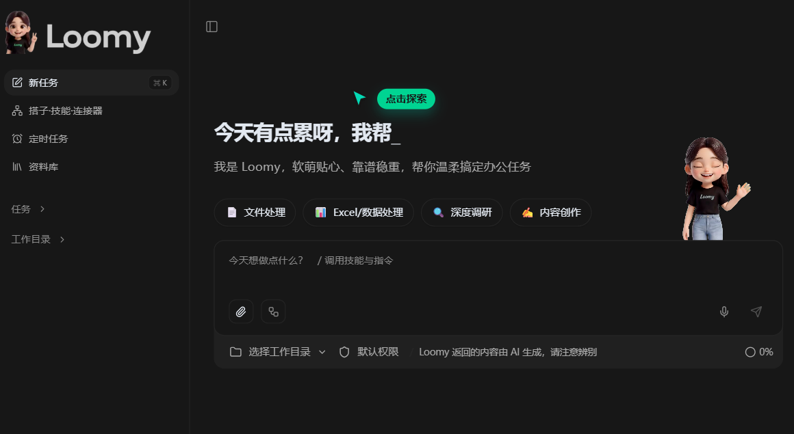
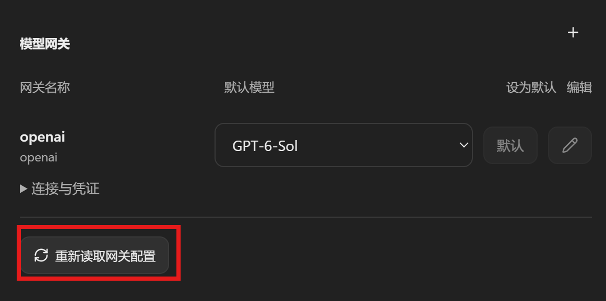
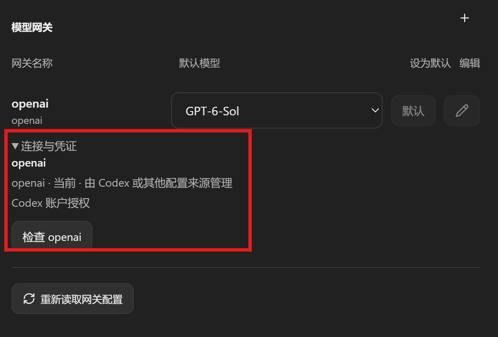
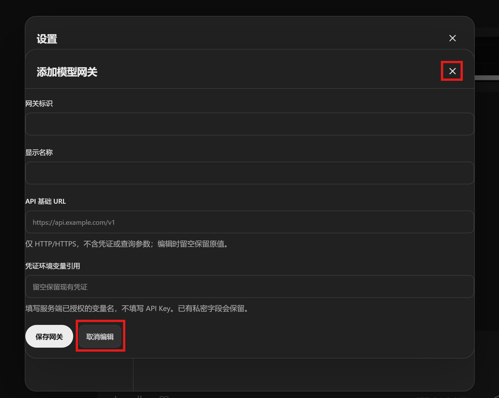
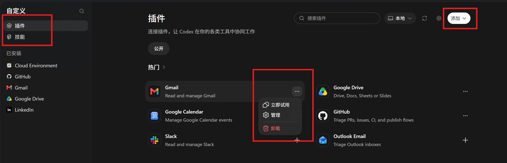
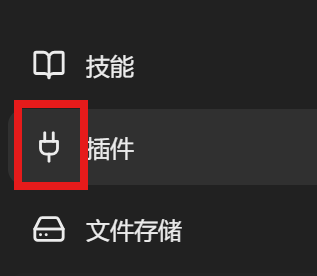
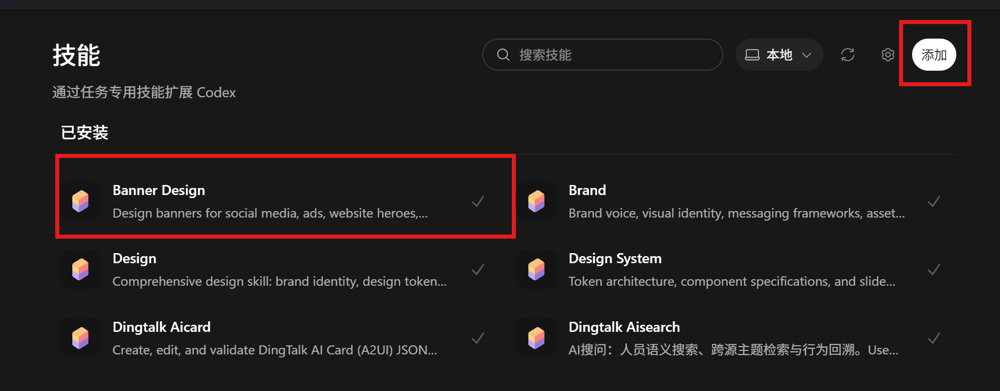

# 界面美化
现在的界面似乎很单调，色彩不够丰富，ico 都是灰色的，你看下下面的这个界面

# 模型网关
这个刷新按钮放在+ 号后面即可，不用文字

不用显示顶部网关名称，默认模型这些标题

不需要显示这些，点击编辑查看

你自己处理这个私钥问题，这里只需要填写私钥即可，你自己使用相关凭证变量完成引用，还有网关标志你也自己处理确保唯一，对于用户只显示名称即可
取消编辑不需要，右上角有X。还有保存网关只需要保存，不需要点名网关，因为已经知道这是网关，请举一反三看看其它模块。还有这个界面布局很奇怪

# 工具连接
插件可以和MCP合并到一个页面，chatgpt也是这么做的

工具连接和插件用了相同的ico，并且这个ico与其他ico不是对齐的，比较瘦小

插件采用点击

# 技能

采用这种形式，瘦长形式，然后一个卸载ico和开关切换就够了，点击整个条进去查看说明；

请基于上述的问题，理解我的意图，举一反三，尽可能参考chatgpt