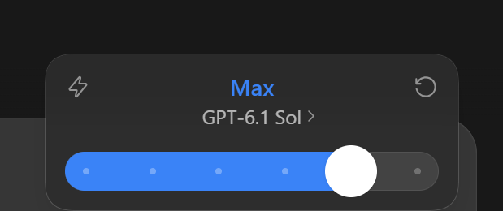
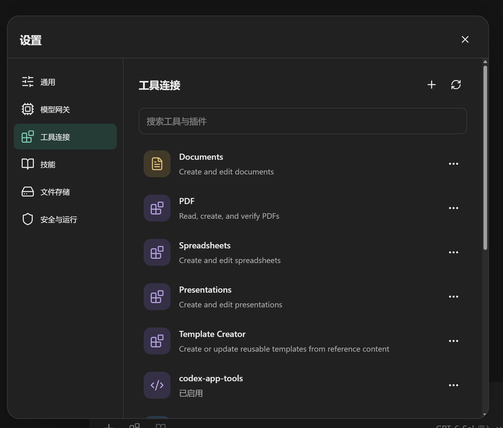
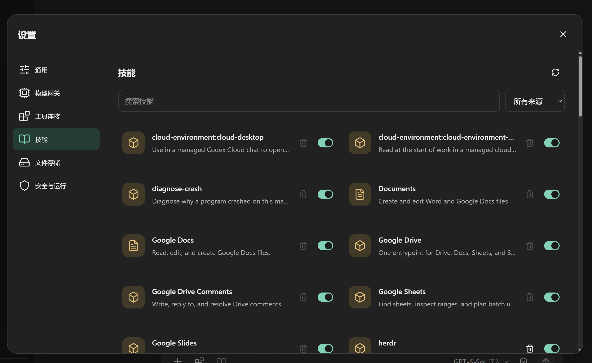
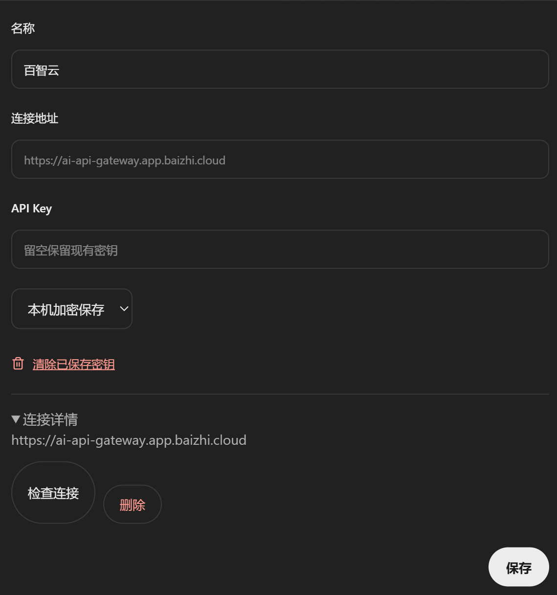

# 推理强度

采用这种多级进度条形式

低，中，高，极高，Max，Ultra

聊天界面模型选择的时候不能折叠某个网关的模型
右边空了那么多空间，一定需要在下面显示兼容性待验证吗，不能右边显示状态码，而且有必要显示吗，不能充分利用空间，同时保持布局美观吗

# 附件
在聊条界面拖拽文件，不需要只针对输入框，能否拖拽刀较大范围都能触发上传

点击插件按钮后，弹出的框不能搜索插件，点击框外区域，框不会消失，并且连续点击多次添加插件，会出现多个连续@@@，应该在第一个插件还未选择的时候不出现第二个；对于这种小问题，怎么才能一下子全部解决呢

# 弹框形式

工具连接和技能切换会改变框的大小，影响观感

# 界面布局
而且配色很AI，白绿色，你需要调研好的配色
这个布局，你瞧瞧

