# 聊天界面
右上角的新建聊条可以删除，避免重复功能，因为左侧有新建聊天
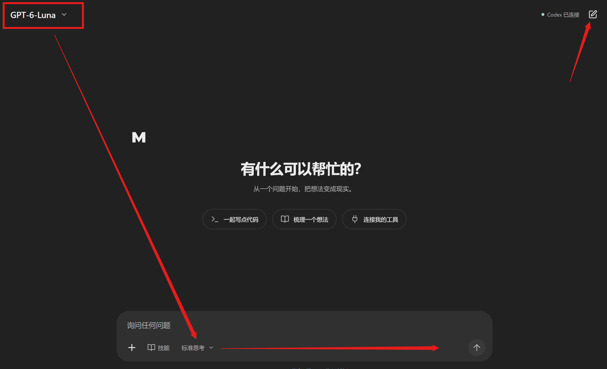

左上角的模型可以和深度思考合并，并且模型列表参考opencode展示所有网关以及实时获取的列表，支持搜索，参考这个
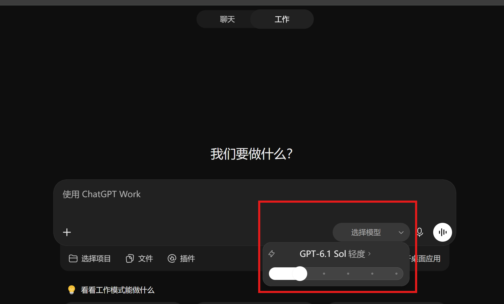
同时参考下这个llama-ui，看下怎么设计模型和思考深度
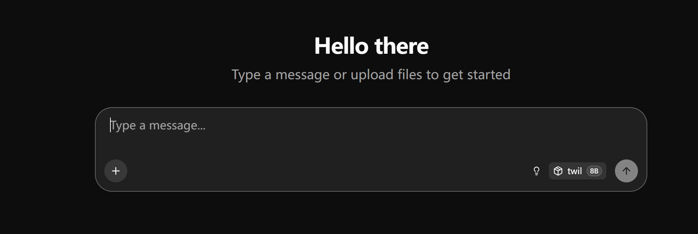

聊天界面支持配置当前会话审批级别
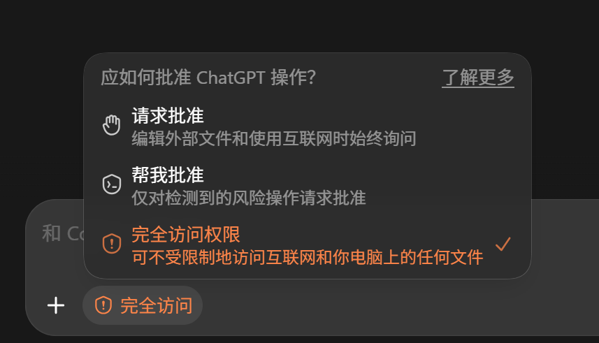

需要支持拖拽文件进入聊天框
添加的需要支持预览，比如点击后，弹出图片预览，文件预览，markdown等

支持$命令选择技能，支持@命令选择插件（注意需要实现chatgpt plugin机制），同时添加插件快捷按钮
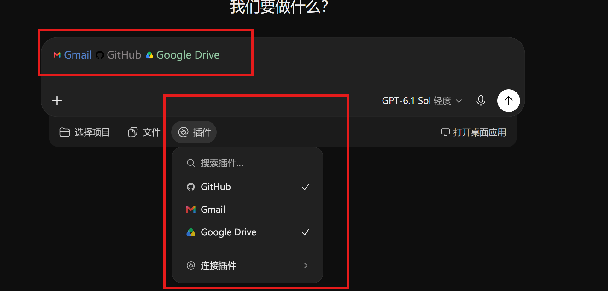

这个添加工作区文件收敛到+里面

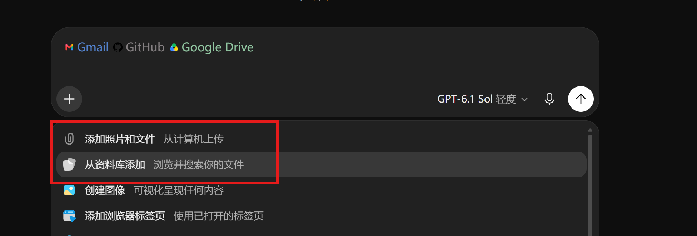

输出界面需要，比如这些需要总体可折叠，并且每行之间需要紧凑一点，默认总体折叠，同时需要显示工作时长动态增长
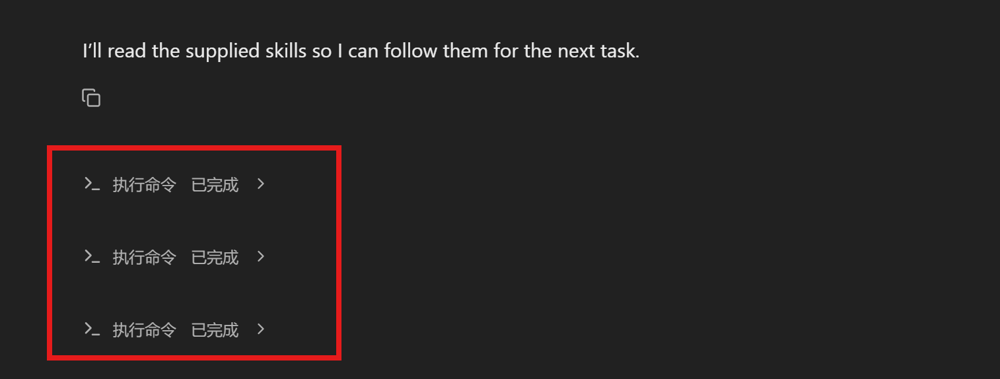
参考
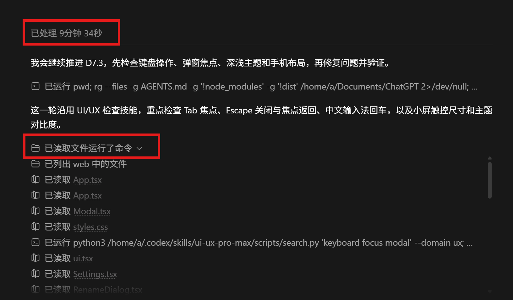

上述只是我发现的问题，你可以对比下chatgpt，查漏补缺，但不要过度添加功能

# 视觉体验
文字格式，不要中英混用，比如 "MCP 连接"
如果 ICO 可以很好的表达意图，就不要添加文字，比如 "+ 新增 MCP"
审查下所有界面，不要过试图去解释某个功能

# Provider
只需要一个列表
每个是个模型网关，并且支持配置默认模型（动态获取模型列表然后选择），并且支持点击设置成默认
右上角为添加一个 + 作为添加模型网关
网关名称 | 默认模型（下拉）| 设置为默认 | 编辑

# MCP
编辑，停用等按钮不明确，看着像文字，不像可以点击的，并且现在只有测试后才能查看到相关按钮，请重新设计布局，同时确保每个mcp卡片等高度
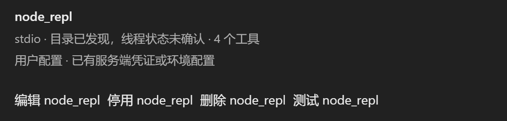

采用chatgpt这种方式程序，具体参考chatgpt
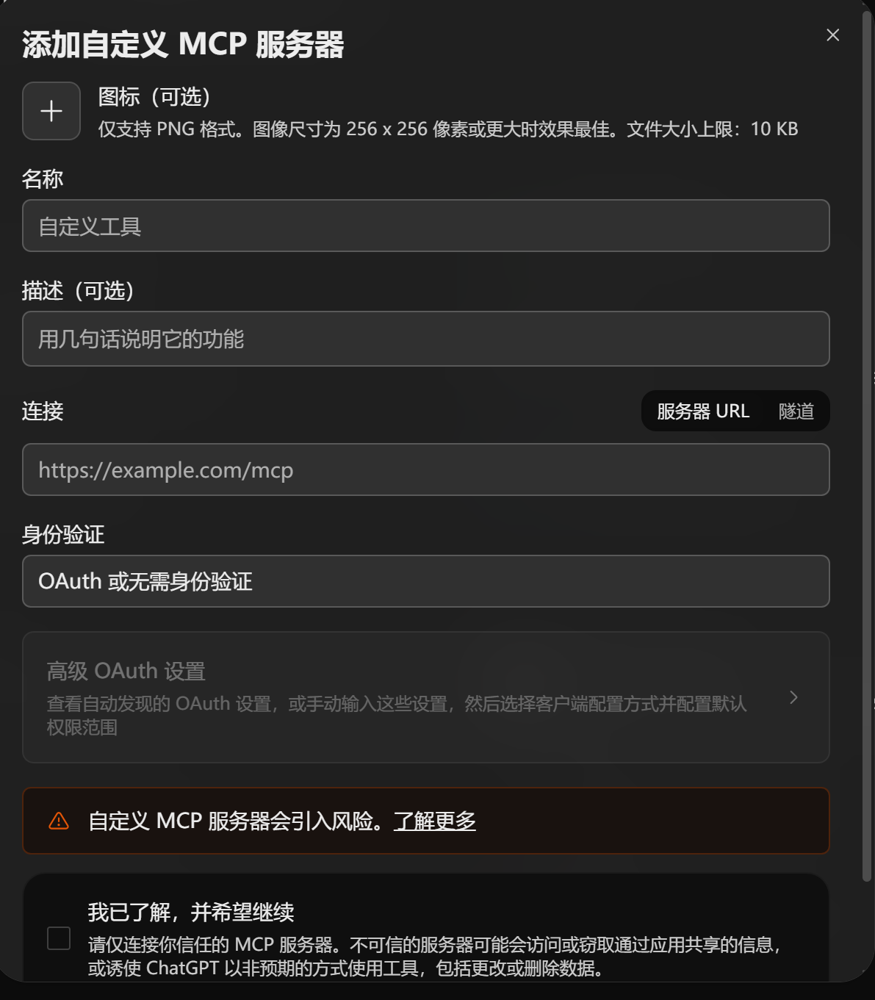
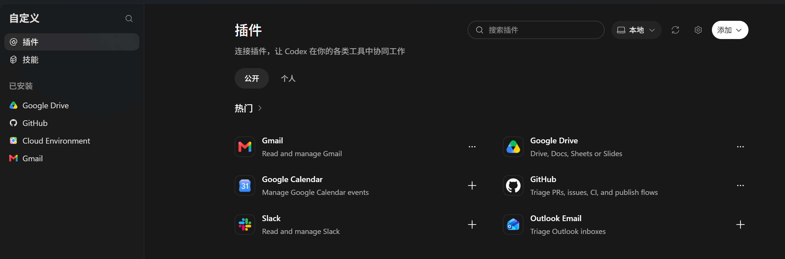

需要支持折叠展示工具列表，比如可以参考下面这个
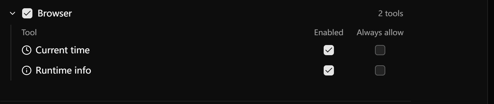

# SKILL
需要支持固定等高显示每个skill，超长则折叠展开，还有现在查看说明看着不像按钮
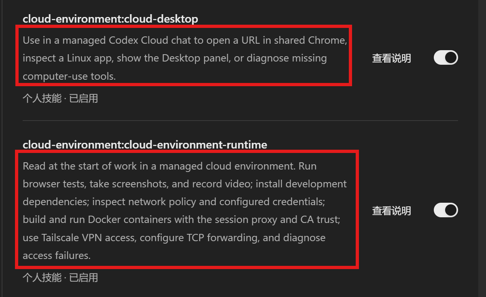

采用这种方式管理，你去深度研究下
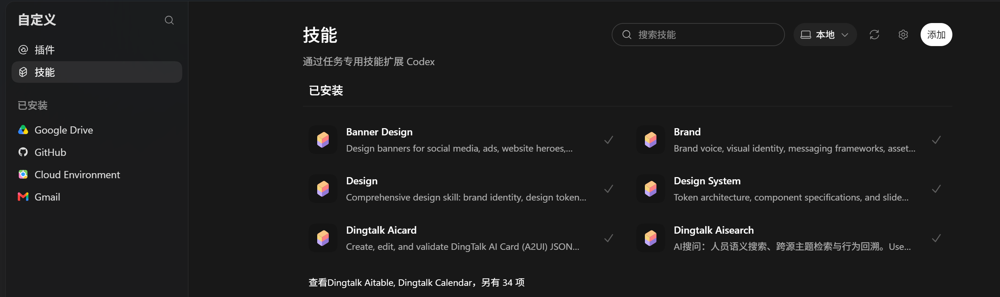