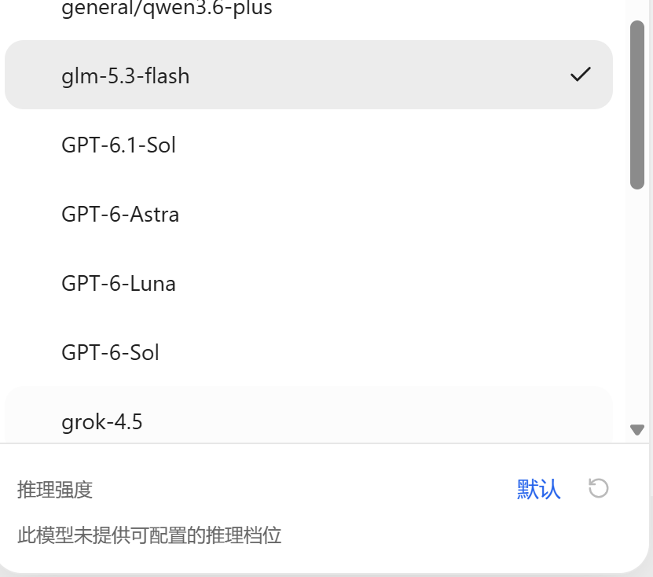
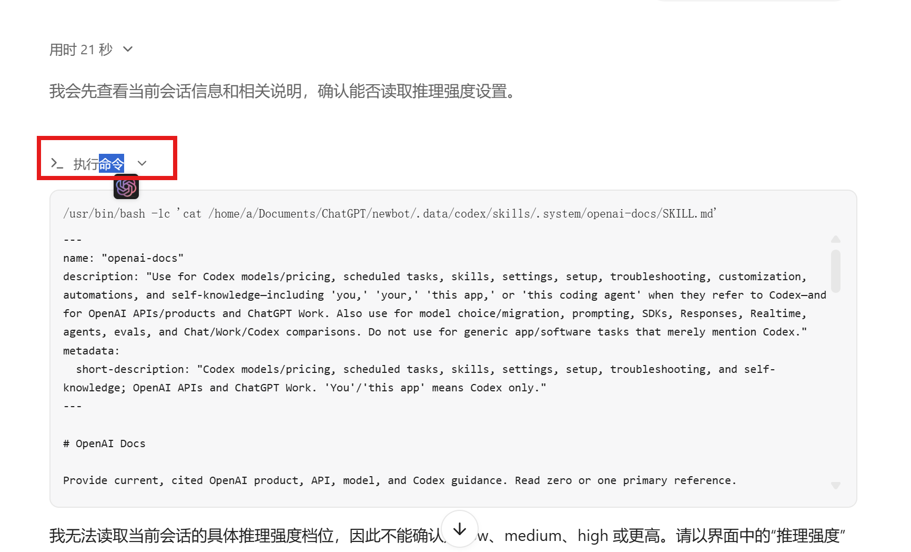
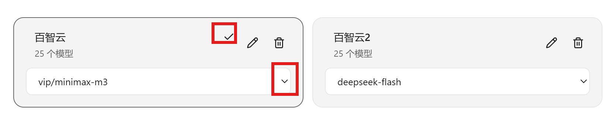

# 01 
这种当需要用户确认是的状态呢？怎么样

不管任何模型都采用：低、中、这些强度

处理过程中无法切换模型和请求批准等，我看chatgpt 支持修改，但是修改提交进入候选（增加skill，改模型等），在下轮请求模型的合适时机自动带上

点击这个展开，出现页面左右变大抖动，聊天窗口理论上不能因为任何行为出现

# 02

评估下这个搜索不用边框呢，效果如何

# 模型网关
名称改成网关，同时不需要这个勾，点击某个网关卡片，选中自动完成设置默认网关，外部框框表示选中并设置为了默认
还有这个下拉框的箭头与边缘贴合影响美观，请思考应该怎么设计

# UI/UX
确保UI/UX用户体验统一，尽量用视觉语义明显的ico，同时统一ico用于，避免同样是编辑，一个用了"铅笔"，另一个却用了"铅笔+框框"
对于高风险应该通过颜色警示，比如某些地方的删除的ico