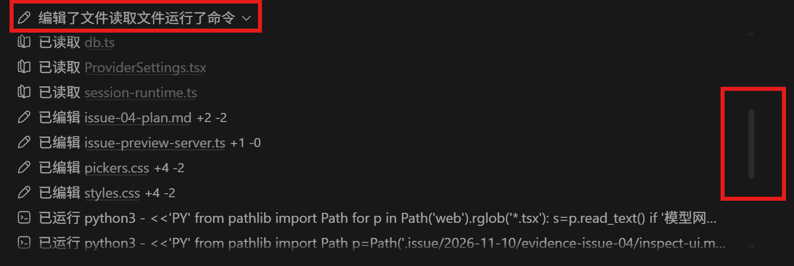
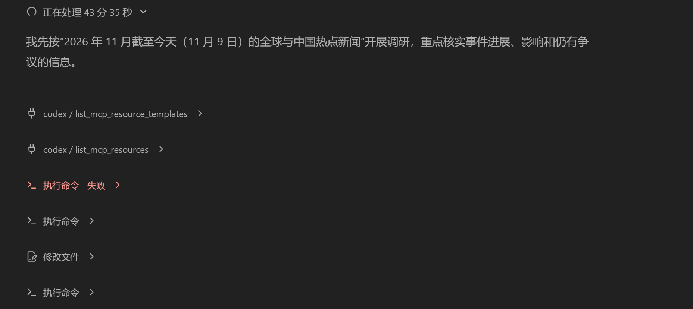
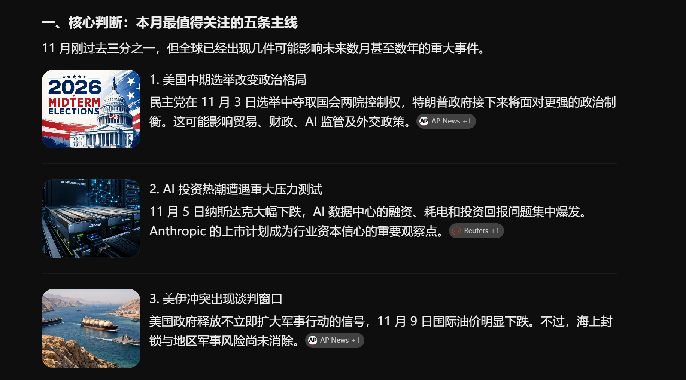
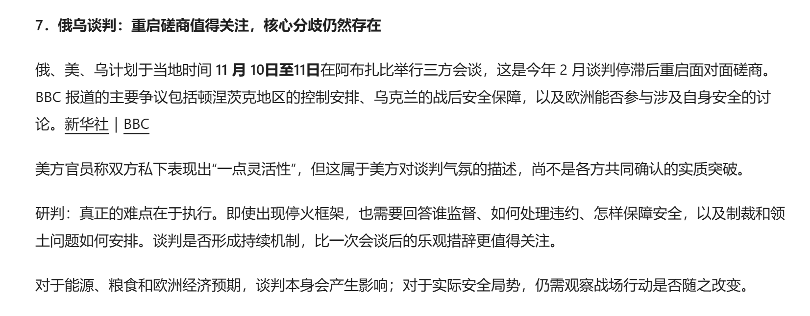
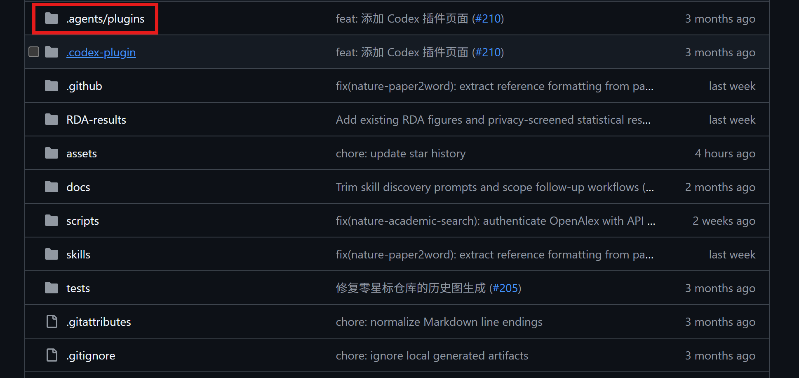

# 要求
以下是我的思考，你需要推理我的意图，评估出有没有更好的方案

# 聊天

折叠展示可以不用全部展开，采用固定然后这滑动方式查看，上下边缘采用一些轻微模糊效果，增加美感，当然只是我的想法，你需要自己思考下类似的视觉处理技术，有可能有更好的方式，

还有你看下下面这个现在的实现，似乎总感觉不够紧凑一样，而且执行mcp命令不如比如执行命令，修改文件这种直观的语义，比如可以叫调用工具之类的呢

为什么总感觉chatgpt的页面很美观，比如输出带图片，还会自动生成图表等，请深度分析chatgpt app如何实现，你可以

这是我们现在的输出

# 扩展
这个“技能”标题是否可以删除，然后搜索等放在一行，保持页面紧凑布局整洁但又不影响美观

# 网关
怎么感觉没有对齐

## 技能
我觉应该加一个添加技能功能，包括本地上传，github导入等，对于导入的包可能有多个skill，不管多少个都需要解析呈现给用户，让用户全选或者多选进行导入
注意导入的有可能是个单纯的skill结构，也可能是个标准的codex plugins格式，你需要按照标准的codex对skill的涵盖这些形式的skill的管理，因为codex已经实现了skill如何管理

