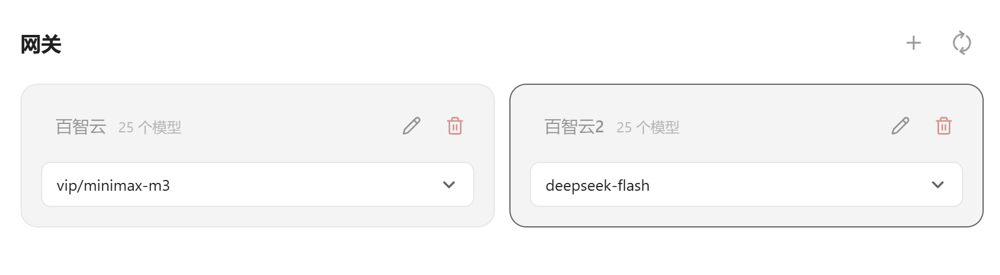
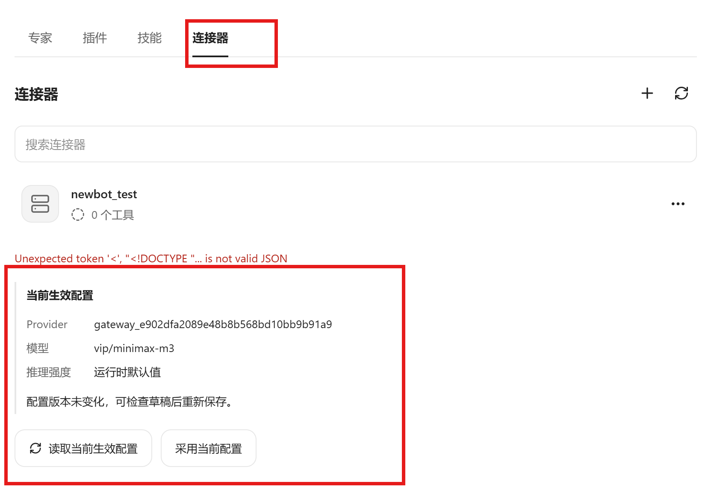
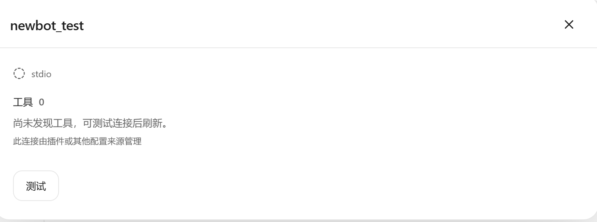
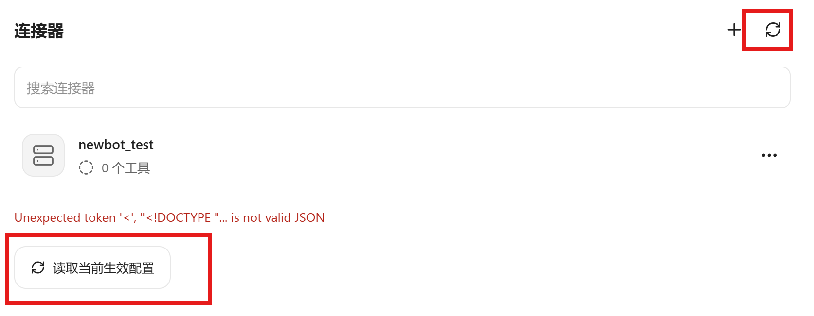
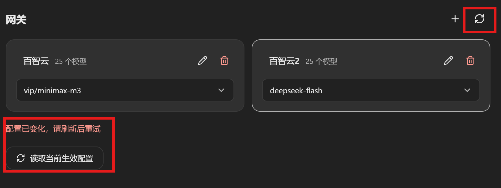
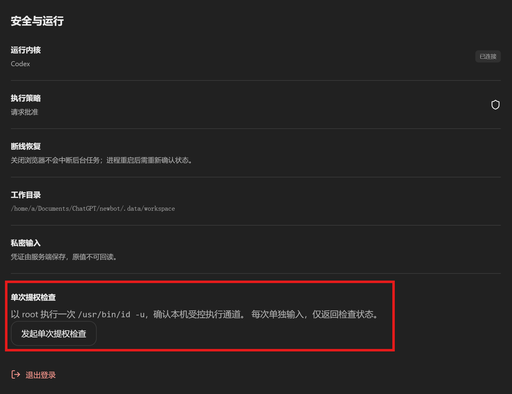
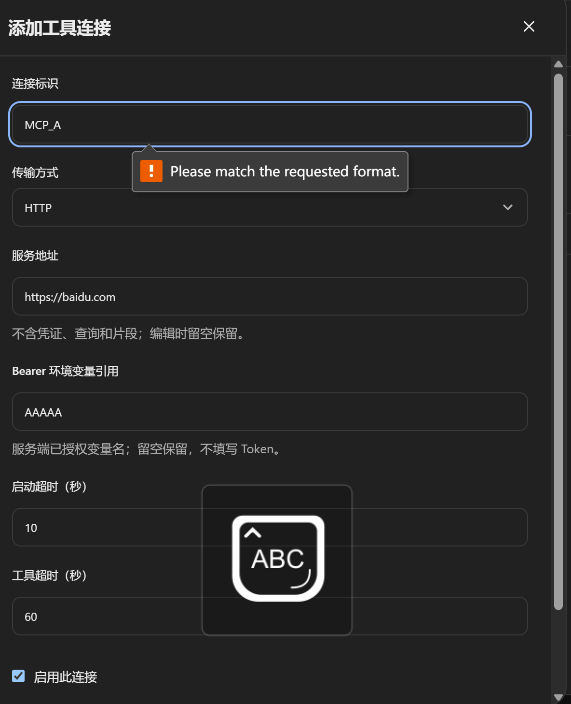
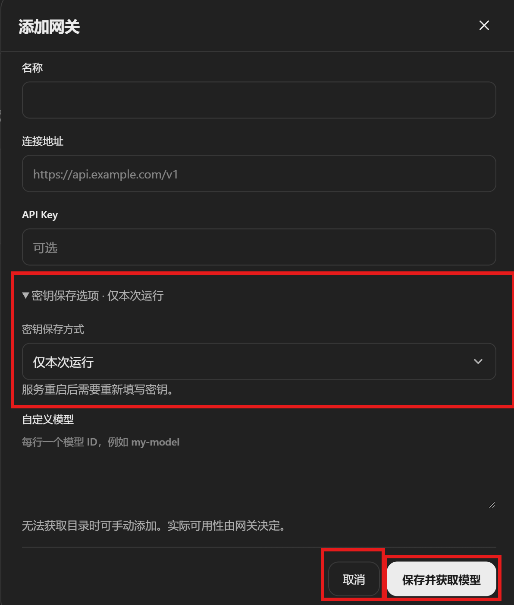

# 01
为什么默认模型切换要这么久，理论上只是写入服务端数据库，之后新启动会话自动获得这个新配置，并不需要下发给已经session会话？请调查

这是什么意思，串了？

界面元素太多了？能也能ico就用ico，比如刷线ico之类的，不要这么多文字按钮，而且测试界面的连接测试都是服务端模拟测试的，并不是使用agent测试，因为这是全局配置

如果有右上角按钮，为何要这个“读取当前生效配置”，还有为什么要读取生效配置，配置理论上就是服务端数据库或文件数据，并不是session中的配置

# 文件存储
直接改成记忆呢？
还有这个是非session关联的，并且位于服务端，用于存储插件之类的吗？如果不是，那么服务端的插件，skill，mcp等如何存储，从而在session创建的时候会在客户端创建一个自己的目录，然后将这些作为项目私有数据按照预先.codex项目级规范，按照用户选择的那些下发到项目中呢？

# 安全与运行
修改名称为安全
在设置界面根本不需要这个什么单词概念（包括其它比如模型网关，mcp配置之类的），而且全局设置界面根本不需要这种单次问题，在聊天界面如果接收到请求输入敏感数据，可以选择一次性还是当前会话直接

# 连接器
这个添加工具连接标题也不对
还有连接标志一值报错，并且http形式不支持配置自定义头以及earer 环境变量引用都是要帮用户处理，用户只需要填写key，或者自定义头等数据都是私密处理呢

本地stdio形式
比如环境变量引用之类，用户看到这个也不知道怎么操作，请分析mcp规范，聚焦用户可能关注点，其它非相关的能自动化处理就处理不要给用增加认知负担

# 网关
取消和右上角的x功能重叠，不需要保存并获取模型这么长的的描述按钮，直接保存呢，然后再页面添加一个刷新的按钮ICO，用于获取模型，下拉框展示，从而决策是否需要自定义模型

# 聊天
为什么

搜索可以放在这，通过ico弹出搜索列表
