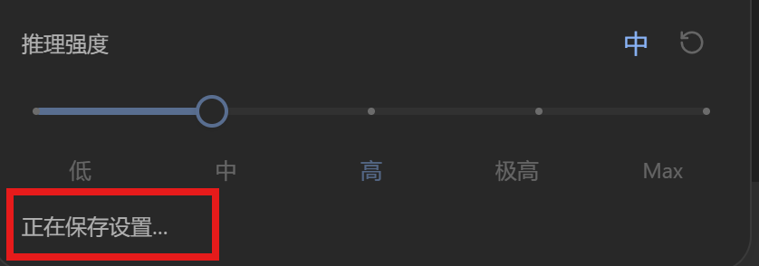
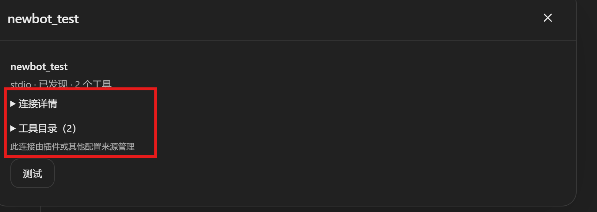
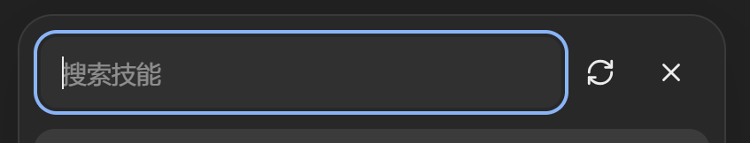
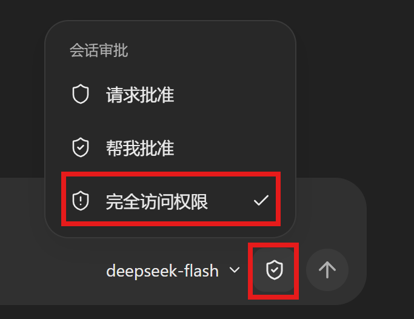
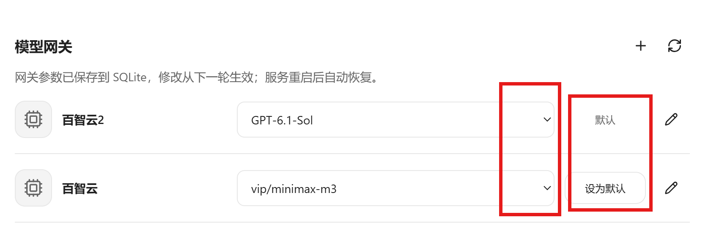
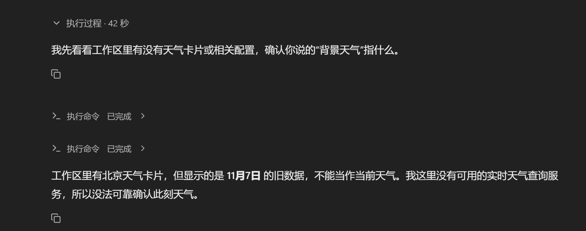
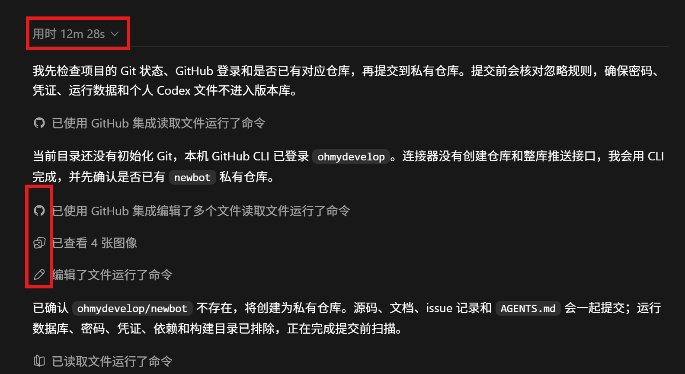

# 
不止一个地方出现这种刷新跳出来导致页面跳动挤压

每次切换聊天都特别久，不丝滑

没必要过度提示，尽可能不要出现非必要提示，用户知道了也没用

还有这个，直接显示工具列表即可，连接详情没必要折叠，而且能用比如点，ico表示状态，尽量不用文字

有没有感觉这个太奇怪了，有点头重脚轻，比例不协调

完全访问权限，这个ico不会变化

模型网关这样很不协调？而且编辑模型也不应该这么复杂，比如临时验证验证当前凭着这个完全没必要出现在界面，只需要修改密钥，测试获取模型列表即可

能不能采用这种紧凑形式呢？充分利用空间，然后在

# 02

折叠的状态

展开的状态，你对比下非常奇怪，点击折叠，这个被点击的应该位置不懂向下展开，现在是向上展开，跳到上面去了

而且这个没有ico，不紧凑似乎，你看下chatgpt的聊天界面

