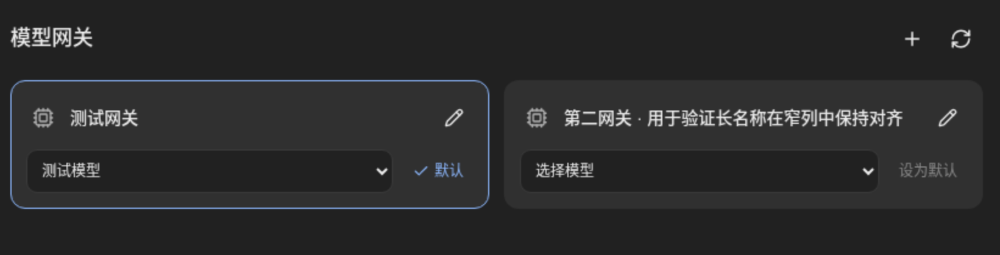
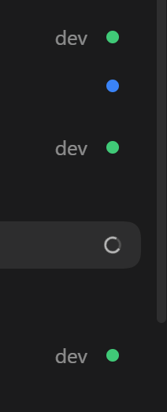
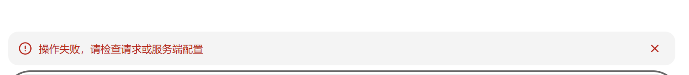

# 模型网关
你看这个模型选择框和没有对齐文字，看起来很别扭，并且不需要默认这个按钮，直接点击这个网关相当于自动配置成了默认网关，
在这个卡片上显示网关名称、模型数量、选择默认模型下拉框、删除、编辑，注意布局美观排版（你需要思考搜索调研一个美观的卡片布局配色应该是怎样的）
在编辑界面需要提供自定义模型，避免有些网关不支持获取模型列表；

# 设置设计

关于命名，可以将 MCP，技能，插件都放在一个页面“扩展”，页面顶部可切换：专家、插件、技能、连接器，因为这些都可以用卡片的形式展示

专家：即自由组合插件，技能，连接器的一个包，通过引用形式，之后再聊天界面只需要@一个专家即可，不需要@多个插件，技能，连接器

# 架构和生命周期

能不能每新建一个聊天相当于基于一个新的目录创建会话，然后与这个会话相关的插件、专家、技能、连接器等都放在这项目的home目录按照标准codex方式，你需要先调研下codex的现有能力
设置里面添加的插件skill等只是放在服务端的静态资源以及静态配置，开启关闭相当于下发到全局 home 目录下

总之全局设置中的每个配置都是存储在服务端的静态资源，启动会话并且聊天根据配置完成同步

# 聊天状态
在左侧的聊天列表，需要有一些标志表示正在运行，异常，成功结束等状态？类似这种

这个会将聊天界面往上挤，评估下浮动分离而与聊天界面挤压呢?

# 方法论

同时你需要调研优秀的产品设计，UI/UX，不要完全作为一个只会干活说啥就是啥的执行者，要有自己主建，学会变通，举一反三，思维发散，多用奥卡姆剃刀，第一性原理等方法论，同时必须基于用户体验设计理论