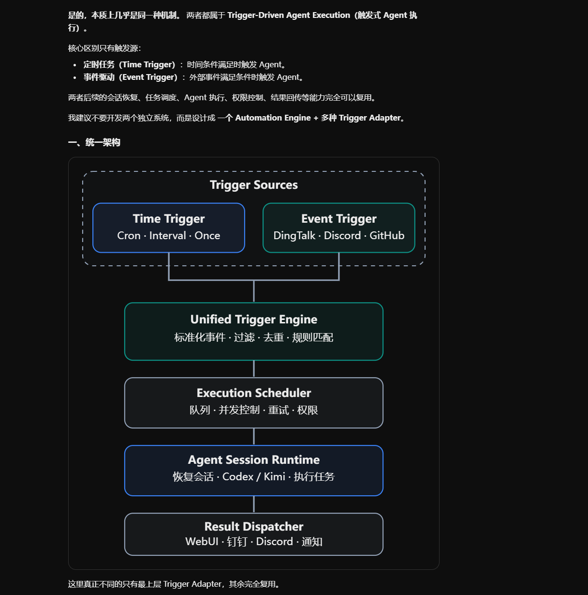
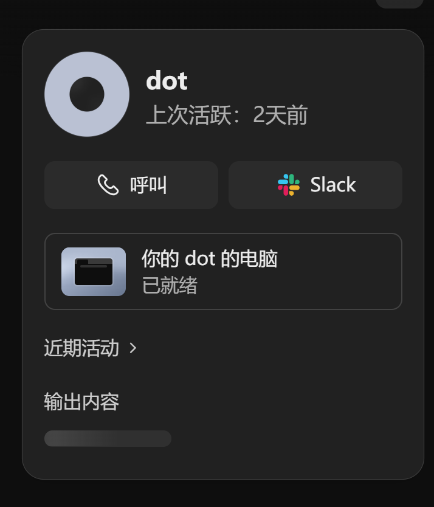
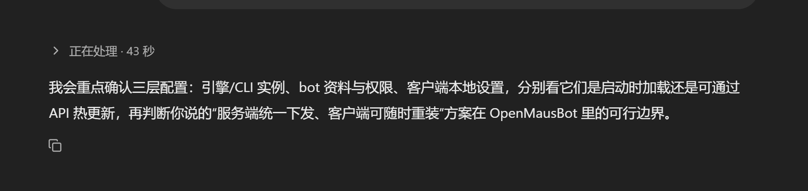

# 触发式 Agent 执行

## 定时任务

支持将聊天对话转换为bot模式

## 事件驱动

调研hermes，openclaw，chatgpt dot，grok bot，manus等，只使用现成的标准规范，这样能更好的接入开源生态
数据来源：比如接入 HIDS 等平台的 syslog，支持同时多个源

数据外发：对接比如对接到钉钉，微信，飞书等。
将所有数据源都抽象成类似聊天软件形式

# 会话状态

后面需要有个标志表示运行状体，同时前面需要一个ico却别表示时触发式会话，还是普通的会话

评估下：每个会话初始化都是普通会话，进入会话后可以打开聊天框右侧的，在里面可以针对当前会话配置插件，skill，mcp，限制当前这个会话只能使用这些外部扩展，不包括内置的；

会话支持多人对话呢

那他怎么管理这些不同agent的配置，是否可以热更新，而不是基于配置文件，而是基于web界面配置后，保存在server通过server直接下发呢，这样客户端即时重置，只要重新安装client即可

聊天界面，这个折叠按钮会折叠所有的，但是主流的是都是折叠到下段文字，后续的折叠是分开的，而且底部需要有个什么动态相关的来表示正在运行，看下chatgpt是怎么做的，
