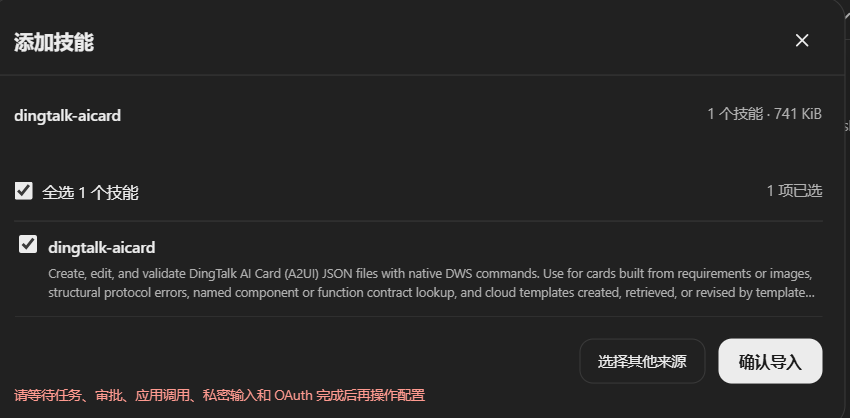
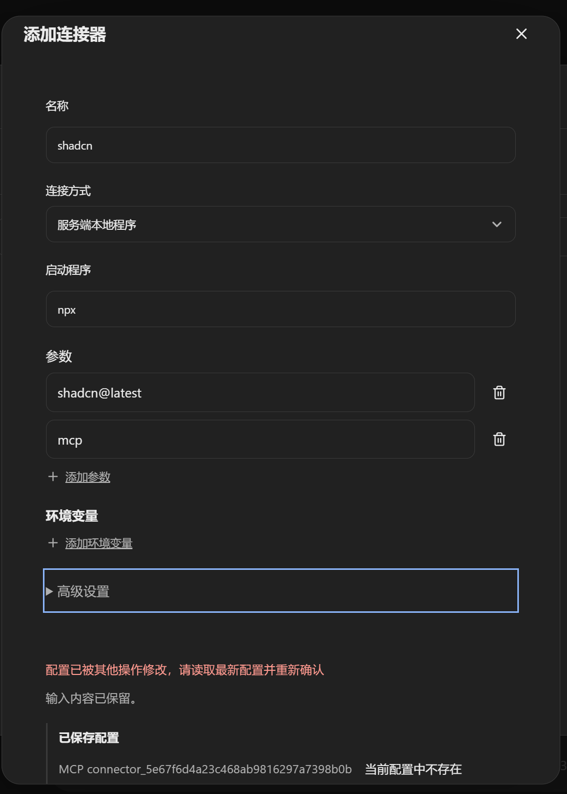
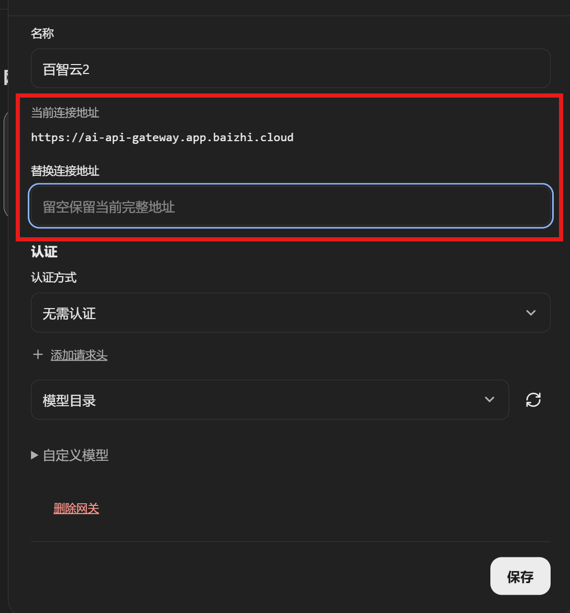
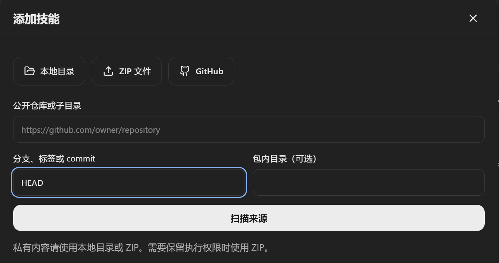
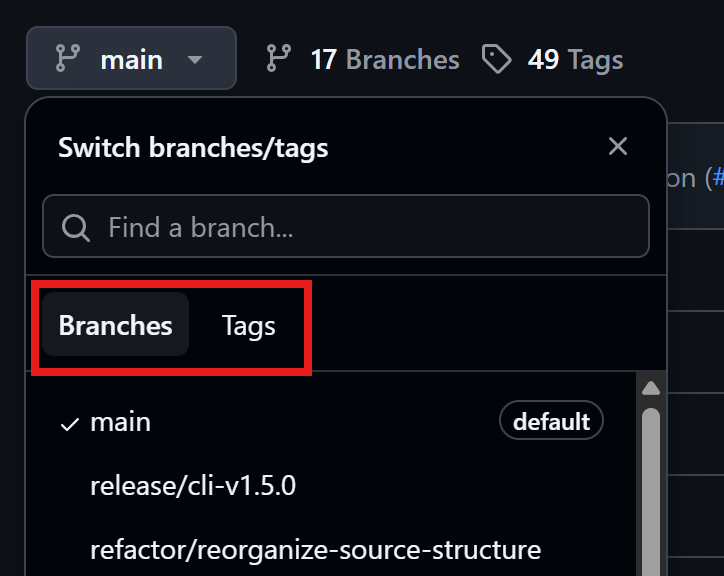
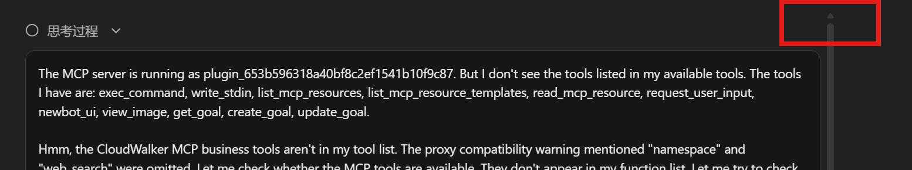
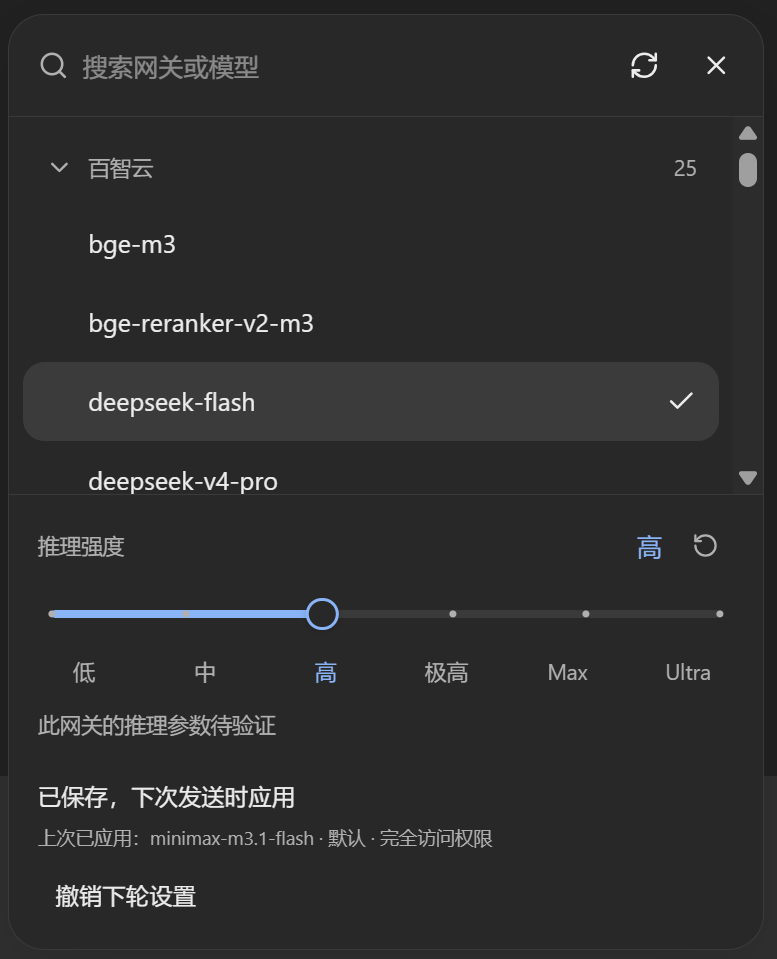
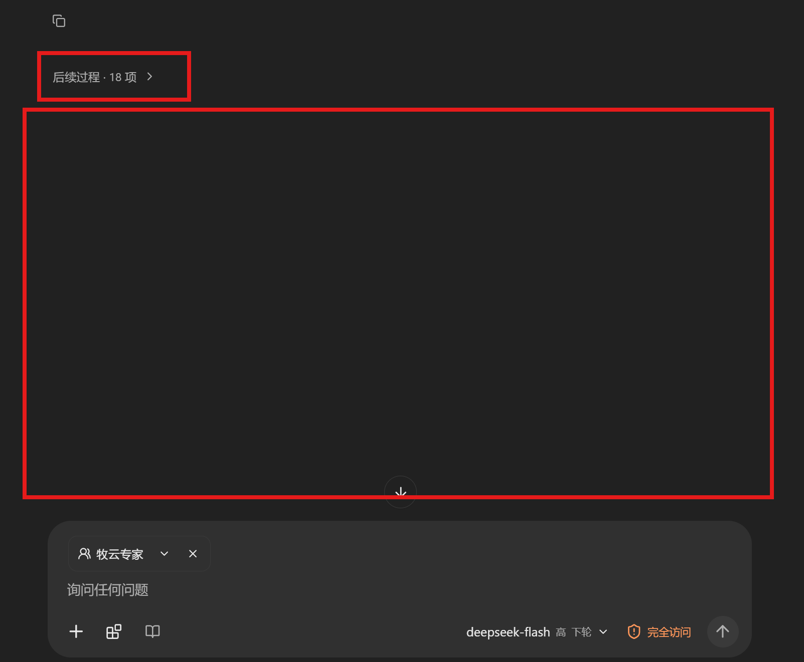
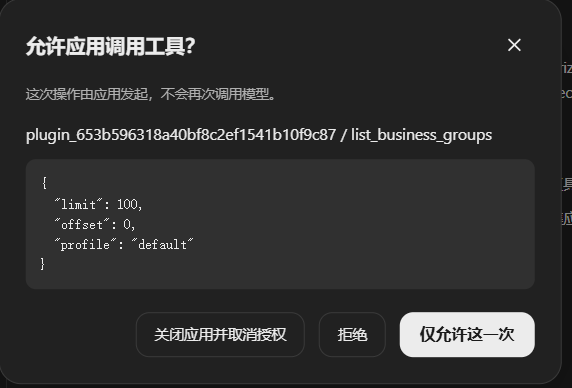

# 添加技能报错

# 添加mcp报错，而且用户交互体验很差
点击高级，按钮就没了，而

# 网关
有些设计就很离谱,就不能直接这个输入框中修改地址吗，而且这里显示无需认证是什么意思，我之前填写的key呢，至少应该提示已隐藏之类的吧

这且这个自定义模型与下面的框框未对齐

这个删除网关外面卡片上不是有了吗，这里为什么还出现

# 技能
github添加时，只需要填入仓库地址即可，自动获取分支或者标签（像github一样展示即可，不需要commit，也不需要包内目录，因为连接中可以包含子目录

# 聊天
这个滑动突出来了，应该仅限于展开的内容

这里的下轮什么意思，是当前会话结束后，再次开启新的会话？能否自动完成这个呢，而不是由用户决策，比如配置完成后，等待几秒之类的或等到下次agent提交请求的时候应用呢，并且也不需要提示用户什么时候生效，要对用户无感；还有推理强度与模型切换分离，通过模型右侧的大脑ico实现配置

这么一大块空白，并且后续过程是不是出现乱序了，本应该在之前显示

为什么开启了完全访问，还是会弹出工具调用？
