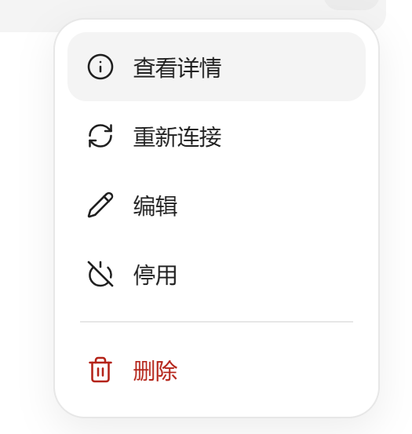
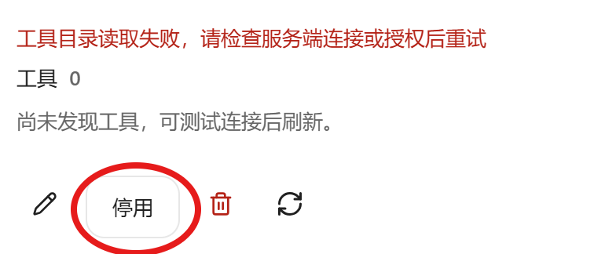

# 统一 ico 心智
“查看详情” 直接改为“详情”

# 聊天
侧边栏聊天的状态是否可以采用这种
鼠标 haver，则显示三个点编辑，否则就显示状态呢？

也就是把下面的状态往右移和编辑共用位置

是否可以在某个位置设计一个显示最近工作时间是多久，像下面这样

# MCP
查看详情改成查看，重新连接改成重连

点击一个mcp工具后，这个停用按钮会很奇怪，其它都是ico，都改成ico即可

请分析是否还有类似的UI/UX问题，排查梳理后一并解决