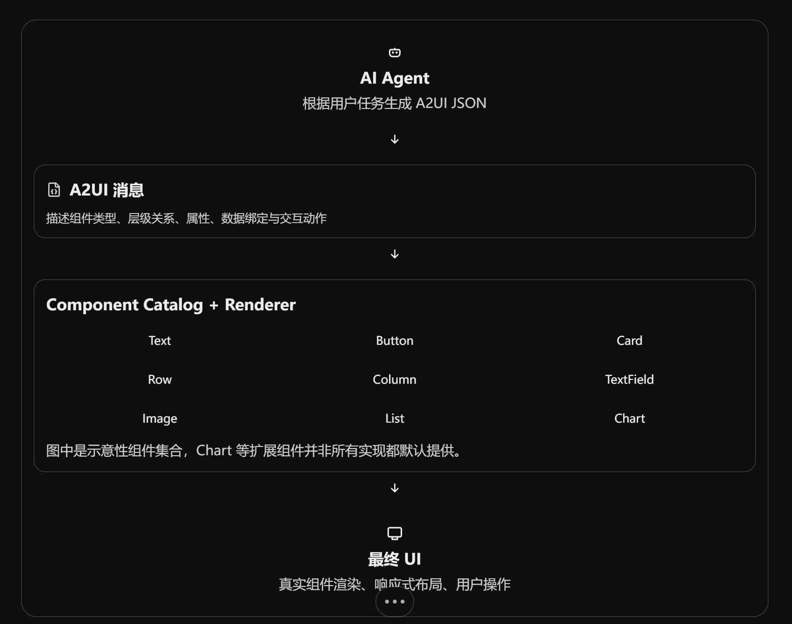

请对当前项目的 **A2UI 系统进行完整重构与现代化升级**，目标是让 AI 能够自主生成具有现代产品设计水准的动态 UI，而不是简单堆叠基础组件。

**核心要求：**

1. **架构标准化**：优先遵循官方 A2UI 协议，采用 Schema 驱动、Component Catalog、Renderer 和 Action 机制，避免重复造轮子。
2. **组件生态**：优先复用 shadcn/ui、Base UI、Tailwind CSS、Lucide、ECharts、Motion 等成熟库，并研究 EasyUI 等第三方组件资源；支持自定义组件注册与扩展。
3. **现代 UI/UX**：建立统一 Design Tokens，支持多主题、响应式、精细排版、视觉层次、Bento Grid、微交互和丰富数据可视化。组件应具备成熟商业产品的视觉品质，而非默认后台模板。
4. **智能组合**：让 AI 根据业务语义自主选择组件、布局、信息密度及交互模式，而不是固定 JSON 页面模板；通过 Schema 约束动态组件树，兼顾设计自由度和安全性。
5. **丰富交互**：支持表单、数据绑定、状态管理、事件回传、加载、错误、空状态，以及流式更新。
6. **安全隔离**：禁止模型直接注入任意 JS/HTML，组件采用白名单注册、Schema 校验和受控 Action 执行。
7. **自动化设计**：引入项目级 UI/UX Skill，指导 AI 分析业务需求、参考图、设计系统与组件选型，自动生成协调一致的界面。
8. **质量验证**：使用真实浏览器进行桌面与移动端截图、交互测试、视觉审查和迭代修复。

**实施原则：** 首先审计现有 A2UI 的协议、组件、渲染器及数据流，在尽可能复用现有架构的基础上完成重构；保持实现简洁、模块化、可扩展，兼容已有消息和工具调用。

**验收标准：** 实际构建至少三种不同场景的 A2UI 界面（数据监控 Dashboard、交互表单、富内容工作台），验证组件动态组合、主题切换、交互回传、流式渲染和响应式布局。

不要只输出设计方案或静态 Demo，直接完成代码重构、集成、测试与真实界面验证。以现代成熟商业产品的设计完成度为目标，同时保证 A2UI 协议兼容性和工程可靠性。