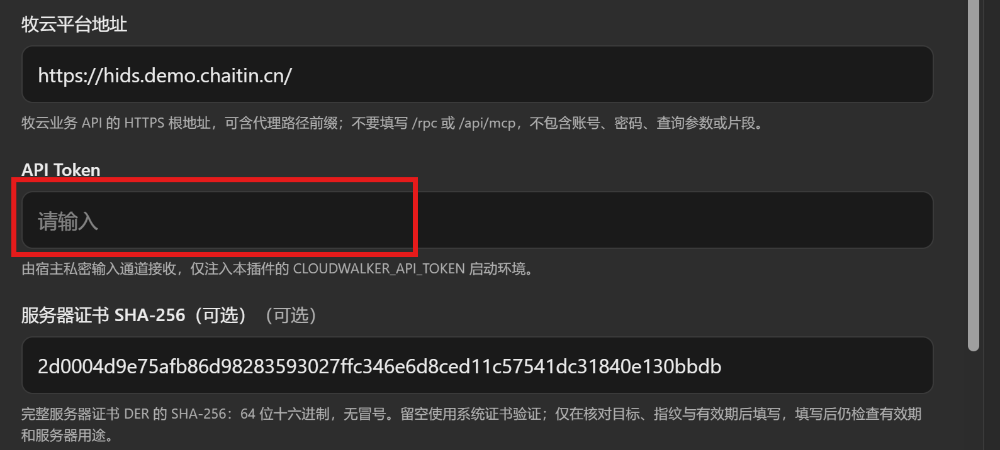
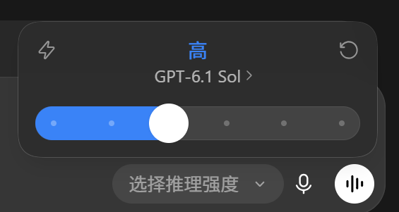
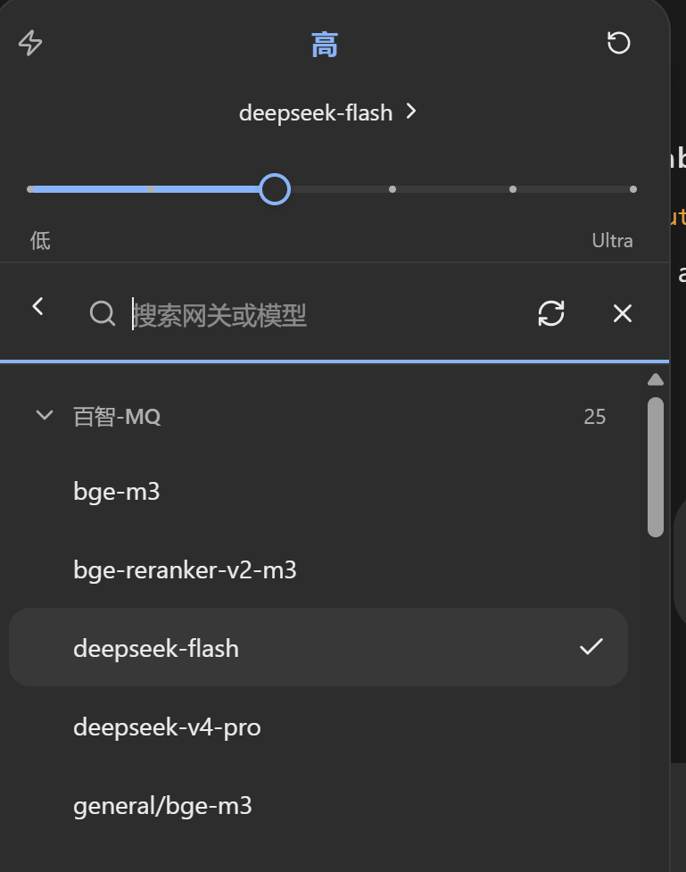

# 插件问题
升级插件后，原来配置的API KEY没了

@后没有弹出插件列表，并且输入对话后，下一轮输入插件就没了
我觉得用户既然用了这个插件，那么就意味着后面较长时间都会使用，是否可以出一个右侧边栏，存放当前会话关联的插件，skill，mcp等呢
在右侧边栏可以进行管理，比如叉掉，这个个右侧边栏具备可扩展性，之后还会用于其它比如子agent管理等

前面没有任何文字@后也不会出现列表，但是紧接着输入文字后就弹出列表开始过滤

# 模型和推理强度
是否可以一比一照搬就行

第二阶段可以选择切换模型，因为切换模型不经常使用

# 
不需要同时显示强度调节，然后也不用那个闪电标志（改成那个返回箭头，统一心智习惯，从模型列表返回到思考强度界面，此时用户如果像关闭思考强度，肯定是继承前者习惯，然后点击返回，当然点击弹框其它区域也可以直接关闭弹框）
