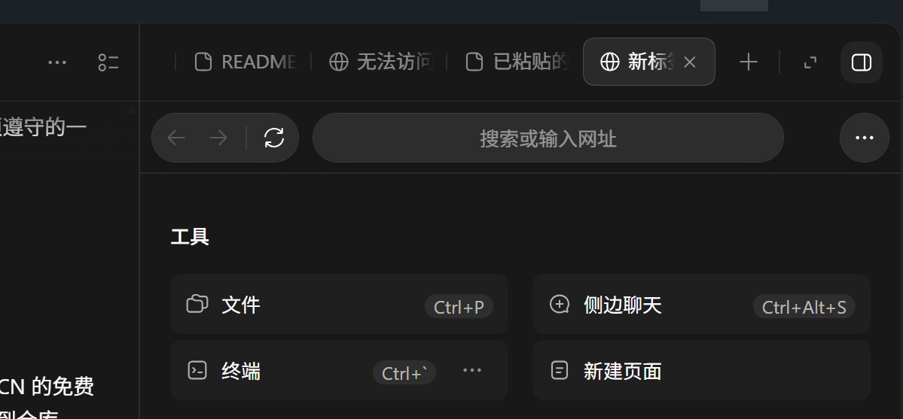
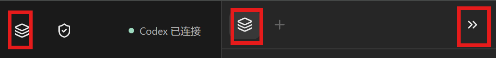
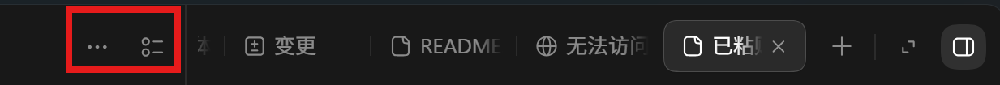
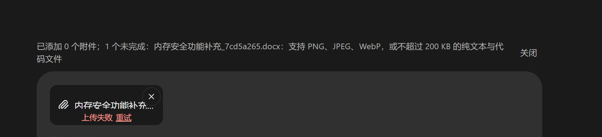
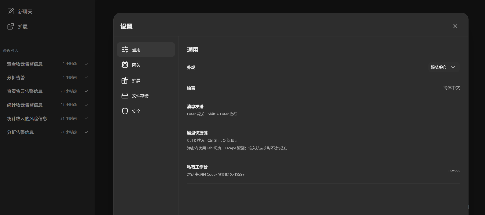

右侧新建应该这样，参考下

侧边栏的ico不对吧，侧边栏点击展开和这点这个按钮位置应该也不变，允许用户在同一位置快速点击查看/关闭，不用移动鼠标，还有那个私密的ico，也要找个合适的布局

私密输入参考这个布局放在中间右上角，折叠后，放在整个页面右上角，在codex已连接之后又私密输入ico，折叠ico

上传文件报错，并且文件上传限制太小了，应该在设置里面可以调整上限

文件存储改成存储
新聊天改成新建聊天
连天界面的左侧扩展去去掉，射中的扩展改成插件，并用@符号作为ico
