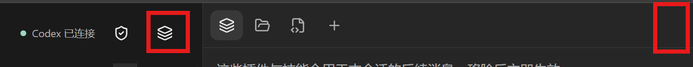
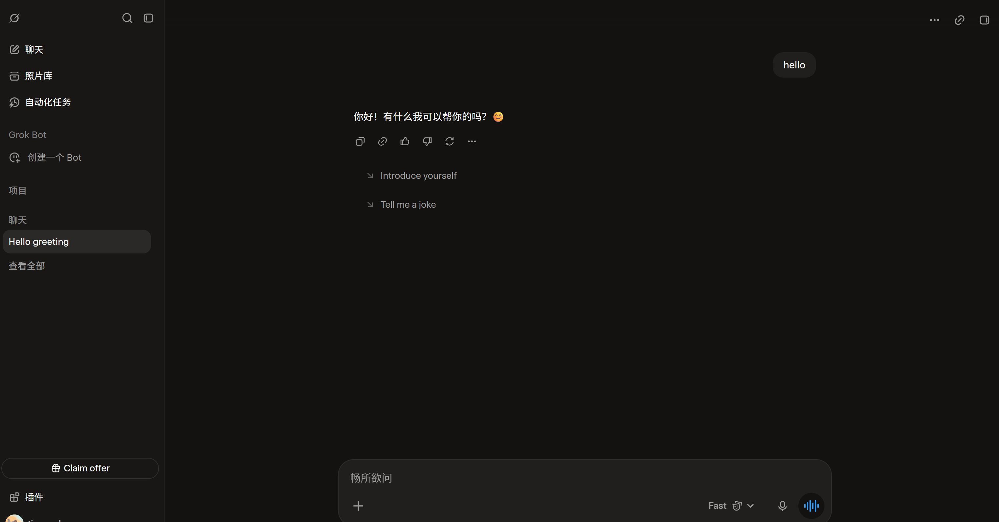
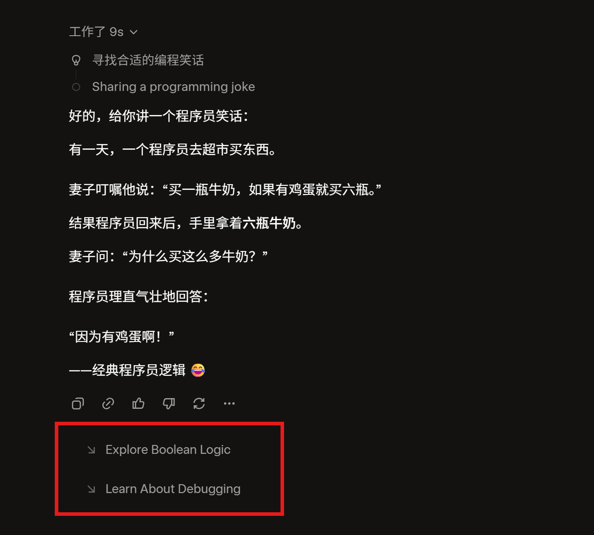
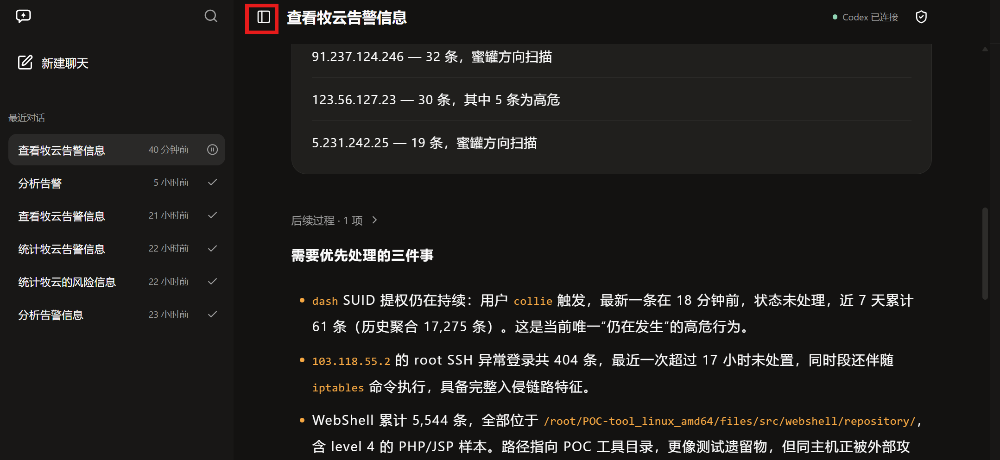
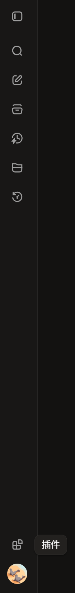
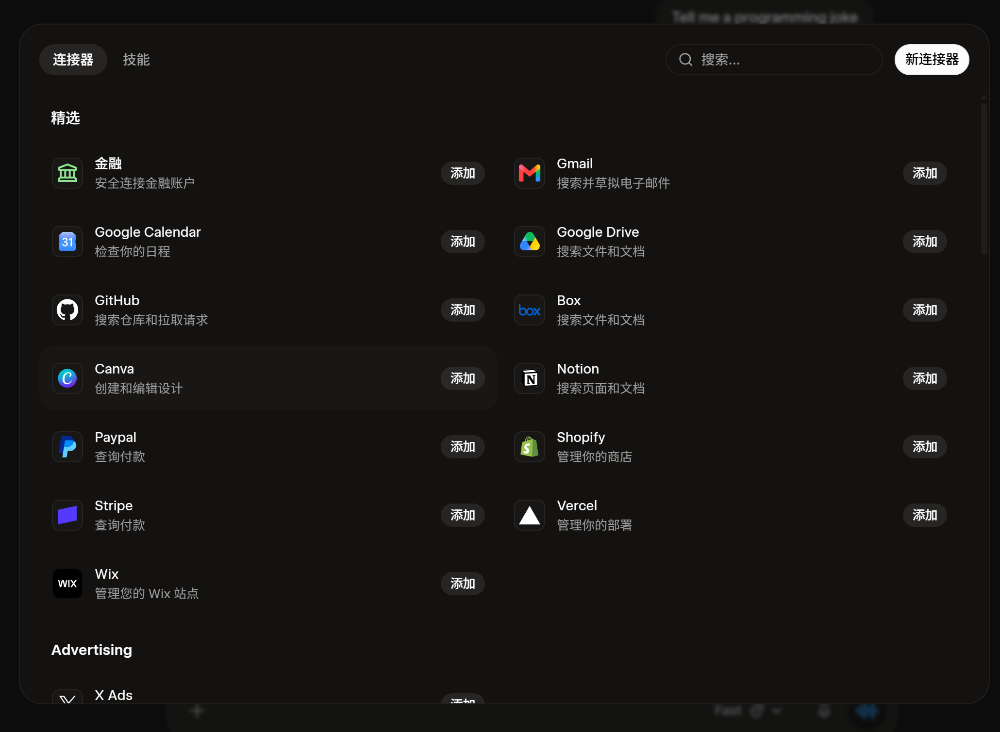

中间和右侧的ico没有对齐，
侧边栏用门的ico，放在右侧，不管打开关闭都在同一个位置，鼠标不需要移动，现在呢点击后直接移动到了中间的框中，应该保持位置不变

再看下，右边这个newbot应该用会话名称，左侧这个产品平成newbot可以删掉

深度分析，看看相似功能实现对齐下，然后配色也按照这个来，包括字体、大小、ico等，你可以下载安装然后使用相关工具深度分析

还有底部的每次聊天推荐的引导

字体颜色太亮，刺眼，左边这个这点应该放在侧边栏里面，而不是放在聊天的这个中间栏

折叠后的应该也是这种效果ICO，然后底部可以放插件配置页面方式，在设置里面删除这个插件配置

插件采用这种布局和排版和设计，当然这里只是他们有应用商店，我们没有商店，因此只需要管理我们的插件即可，每个插件后面不用添加
