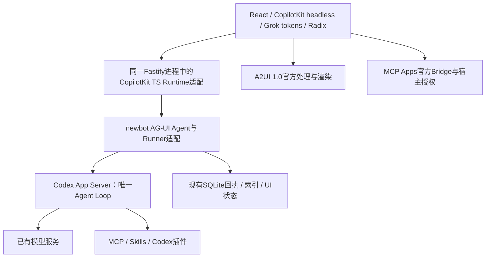

# STACK-02 · Codex + CopilotKit + A2UI 1.0 迁移计划

日期：2026-11-14。状态：方案制定完成，实施尚未开始。
源码检查点：`d9f9d56`，已推送 `origin/main`。本计划与版本调查单独提交。
前置调查：[STACK-01](stack-reuse-audit-plan.md)。进度：[本轮进度](stack-modernization-progress.md)。版本及关注度：[官方注册表/API快照](stack-modernization-metadata.json)。

## 1. 目标与决策

用户目标：在轻量、私有化、Codex后端、多模型、MCP Apps和既定Grok视觉的前提下，优先采用当前活跃、广泛使用、有可靠厂商/基金会支持的方案，减少自研基础设施维护。

主方案：**Codex + AG-UI + CopilotKit TypeScript Runtime/React headless UI + A2UI 1.0 + 官方 MCP Apps SDK + Radix，按需采用 shadcn/ui 的 Radix 组件。** ECharts等已采用成熟库继续保留。assistant-ui作为明确的降级候选，不同时部署两套聊天状态。Motion仅在复杂布局动画需要时引入；Monaco仅在新增实际代码编辑需求时使用；Cult UI、第二个AI SDK Agent Loop、云端Intelligence不作为必需项。

“最新”指调查当天npm latest稳定渠道与官方协议，之后选择通过兼容验收的精确版本锁定；不用canary，也不在生产运行时自动追latest。“最受欢迎”没有统一跨领域排行榜，本计划采用同层候选GitHub关注度、最近维护活动及官方生态资料作为证据，不以stars替代质量。“厂商背书”分别记录官方维护、基金会治理、生态合作，不能混为官方担保。

当前实际行为：已采用官方协议核心，但聊天基础交互、执行过程和多处控件组合依然自研；多轮问题涉及共享状态、事件边界、组件一致性。期望行为：成熟库承接通用实现，newbot仅保留产品约束和必要适配；用户的旧聊天/配置/附件/专家/工具能力不丢失。

## 2. 选型、支持来源与当前版本

| 层次 | 决策/候选版本 | 支持与选择理由 |
|---|---|---|
| Agent | Codex目标0.169.0；迁移初期保留已发布fe2f185-connector-ca | OpenAI官方；三份现有补丁须与新上游逐项比对，已合入者删除，必要差异重新验证 |
| Agent前端 | CopilotKit react-core/react-ui/runtime **1.88.0**，采用v2导出 | CopilotKit维护；Google A2UI团队官方联合文章展示其集成。是生态合作，不是Google拥有/保证CopilotKit |
| 通信 | @ag-ui/core/client/encoder 1.0.4 | 当前core/encoder已使用；以标准契约取代重复事件适配，newbot扩展仍显式保留 |
| 动态UI | A2UI **协议1.0**；web_core latest **0.15.0**；渲染优先验证CopilotKit a2ui-renderer 1.88.0 | Google A2UI团队11月11日发布1.0；包版本与协议版本分别管理 |
| MCP Apps | @modelcontextprotocol/ext-apps **2.0.4** | 官方扩展；MCP维护者与OpenAI/MCP-UI合作，已有多家宿主支持。现有AppBridge保留直至替代实现功能等价 |
| 基础控件 | 已用Radix按需补齐；Dialog latest 1.3.1 | WorkOS维护；沿用现有行为基础，避免同时引入另一套底层原语 |
| 组件配方 | shadcn/ui按需选Radix版本，记录registry来源/hash | Vercel官方生态与高关注度；复制后属于本仓库维护，不能承诺自动上游更新；不全量拉取、不覆盖既有Grok tokens |
| 图表 | ECharts **6.1.0** | Apache项目，当前已用，不更换 |
| 动效 | CSS为默认；Motion **14.14.0**为按需候选 | 活跃社区库，不虚构“大厂官方维护”；必须证明复杂交互和维护收益 |
| 编辑器 | Monaco **0.57.0**为后续候选 | Microsoft官方；本轮不新增编辑器，Shiki继续负责只读高亮 |
| 备选聊天 | assistant-ui/react **0.15.36**、react-ag-ui **0.1.10** | 外部store适配与现有Zustand契合；当主方案未满足轻量/私有化/行为约束时启用，不同时引入 |

GitHub API本次快照：CopilotKit 38,694 stars、assistant-ui 13,114、A2UI 17,320、AG-UI 17,170、Radix 19,500、shadcn/ui 128,141、Motion 35,122、ECharts 67,720、Monaco 46,969、Codex 135,204。只能在适当类别内比较；仓库体量和存续时间不同。具体取数时间、仓库地址、最新push和license见metadata，不将今天值写成长期保证。

### 已发现的版本门槛

1. 当前newbot实际使用A2UI `/v0_9`，catalog `newbot:ui/v1`/`v2`不是协议版本。新版web_core 0.15.0公开`/v1_0`；但@a2ui/react 0.15.0的exports未列`/v1_0`。根入口是否覆盖1.0、CopilotKit渲染器实际能力均需按发布代码验证，不能根据官网表格假定可换。
2. @a2ui/react 0.15.0仍声明Zod3 peer；仓库主入口为Zod4，当日注册表确认其依赖的@a2ui/markdown-it latest仍为0.2.2，peer要求web_core ^0.14.0，与React包要求的^0.15.0不相交；CopilotKit a2ui-renderer1.88.0则直接依赖web_core0.15.0，没有该markdown-it依赖。只读元数据并不等于依赖可安装，本计划不使用`--force`或`--legacy-peer-deps`掩盖冲突。
3. CopilotKit 1.88.0已公开v2导出；react-core依赖web_core 0.15.0与自身a2ui-renderer。多个SDK可能导致双版本核心/重复渲染，必须检查lock和实际bundle。
4. CopilotKit TypeScript开源runtime可不连接Intelligence；生产`selfManagedAgents`直连被官网列入Enterprise。采用本机runtime路径，不以开发选项绕过生产条件。历史存储沿用应用自身实现，不购买云服务来掩盖恢复问题。
5. runtime的许多provider peer是optional，不因为列表出现就全装；需审计实际依赖树、浏览器网络与遥测设置。不能把“支持自托管”当成“默认无外发”。

## 3. 目标边界与所有权

- Codex持有执行、模型与原生聊天历史；不用CopilotKit BuiltInAgent替换或新增模型循环。
- newbot持有认证、请求防重、配置、私密输入、审批与应用资源授权。适配必须调用现有服务，不直接绕过Bridge调用Codex。
- CopilotKit负责选定的聊天呈现和Agent前端交互。Zustand保留shell/配置状态；聊天数据只保留一个权威来源，阶段性适配是只读投影，不双向写两套历史。
- AgentRunner的run/connect/isRunning/stop映射现有稳定requestId、事件cursor、活动状态和取消操作。connect只能接续，不能重新run；浏览器断开不意味着取消任务。
- v2 HTTP handler与Fastify的Request/Response、cookie/session、Origin、SSE取消、poll回退适配先验。不为接入强迫迁移Next.js/Express，不默认加数据库或进程。
- A2UI是声明式本地组件；MCP Apps是第三方沙箱应用。可以共同出现，但权限和生命周期各自维护，不能合并为任意HTML渲染。

## 4. 不变量和同类风险

| 级别/机制 | 当前证据状态 | 关联范围、验证方法及纳入理由 |
|---|---|---|
| P0 重复执行/断线重连 | 有代码证据：newbot有持久回执，目标Runner有run/connect分工；迁移尚未复现 | 普通/纯附件发送、重试、刷新、切换、重复点击；同requestId仅一个native turn，connect不能产生turn |
| P0 状态归属/迟到结果 | 有代码证据：现有revision与OAuth loginId隔离 | 聊天/工具/A2UI/授权；旧会话事件不能覆盖新会话，旧OAuth结果不能释放新尝试锁 |
| P0 Host权限 | 有代码证据：现有独立origin、单次授权、工具可见性策略 | MCP Apps新旧入口/新框架tool UI；资源归属、拒绝、过期、跨线程调用均覆盖，默认新库能力不得扩大现有授权 |
| P0 凭证/遥测 | 待验证新框架；现有私密消费者路径有代码证据 | OAuth/Token/CA/Provider；不能由普通聊天或第三方遥测接收凭证，运行网络记录用合成秘密验证 |
| P1 A2UI协议/历史 | 有代码证据：v0.9硬编码与新exports差异 | 普通/富组件、action、草稿、快照、切换、恢复；新写1.0、旧数据按原版本读，不原地修改原始历史 |
| P1 组件交互 | 已有用户反馈与历史修复；新框架待验证 | 折叠思考、步骤状态/图标、嵌套滚动、附件分块、输入即时提交、插件状态。共用组件必须覆盖全部入口 |
| P1 原生更新 | 有代码证据：当前3份补丁 | 模型切换、插件目录、私有CA、OAuth、恢复，比较上游后逐补丁验证；不得直接替换npm包就声称运行内核升级 |
| P2 资源体积/依赖冲突 | 有元数据证据，性能待验证 | 首屏、面板、A2UI/MCP Apps与图表懒加载；避免将可选provider/map库打入浏览器，固定版本可复建 |
| 外部服务的全部兼容性 | 待验证，非本轮计划已完成项 | Slack真实workspace授权、token刷新仍保留GCF-10边界；需外部账号参与时单列验收，不拿合成OAuth通过代替 |
| 扩展需求 | 不适用 | 不新增多租户、RAG、多Agent框架、远端消息发送、Claude/Grok转换器或Monaco编辑器，避免迁移无限扩大 |

## 5. 实施阶段和可交付结果

### M0 基线与冻结
- 在`codex/copilotkit-migration`隔离分支/工作树开展实施；本轮只制定计划，不创建并运行新产品。
- 为当前源码检查点建立可复建构建、数据库与native来源记录；补齐基准数据集：短聊、500条消息、含20个工具步骤的长流程、纯附件、多媒体、A2UI、MCP App、待审批。
- 固定同一浏览器/机器/网络条件测5轮基线：发送到乐观UI时间、UI首屏JS gzip、CPU/内存、打开深层面板、滚动帧行为；记录手机320/390/桌面1280与明暗主题。
- 交付：baseline.json、真实界面截图、现有测试对应表、删除候选清单；不改变用户生产数据。

### M1 最新版本与私有化可行性门槛
- 独立最小工程精确锁定CopilotKit1.88.0/v2与所需A2UI组合；检查exports、peer/optional依赖、许可证、遥测开关、可复建安装。A2UI渲染器选择只保留一条新版本路径。
- 挂载Fastify适配，使用合成AG-UI记录确认run/connect/stop、cookie/Origin及SSE/poll边界；不新增AgentLoop。
- 交付：依赖锁、最小适配样例、请求/响应契约和网络审计。安装冲突未解决、必须依赖付费服务或同一turn重复执行均不进入M2。
- 若新版发布包尚不支持所需A2UI1.0，记录具体缺失并保持旧路径；优先官方可用修正版，不自造1.0处理器、不伪改版本。

### M2 Codex—AG-UI—CopilotKit完整纵向链路
- 自定义AbstractAgent与AgentRunner只包装现有newbot请求与事件服务，保留threadId/runId/requestId映射；订阅终止不触发任务取消，stop仅作用当前匹配turn。
- 把TEXT/REASONING/TOOL/STATE/CUSTOM事件映射及newbot扩展写入契约；确定消息转换、历史恢复、分支/分页、附件ID、审批与追问的位置。
- 先跑模拟失败竞态，再用现有真实模型完成无工具对话和停止；合成与真实证据分别保存。
- 交付：一次发送一次执行、重连不重发、切换不串会话的可观察证据。历史所有者仍为Codex/newbot。

### M3 聊天界面替换
- 复用CopilotKit headless/组件能力，保留Grok主题、导航和图标层；迁移消息列表、composer、消息操作、工具/思考呈现。
- 用户点击发送后本地立即出现消息/附件，按钮立即变运行状态；文字与附件分块；专家/Skill/插件发送后留在侧栏控制；动态追问失败不展示固定兜底。
- 思考默认折叠；每一步显示可读标题、正在执行/完成/失败/取消；统一图标槽与线宽；滚动到流程边缘能继续到整页。
- 交付：原用户截图对应的逐项回归与可访问键盘验证。删除被接管的旧列表/输入/滚动基础实现，不保留永久双渲染开关。

### M4 A2UI 1.0与MCP Apps
- 采用官方1.0模型、校验及渲染；Catalog映射现有组件。旧v0.9快照只读兼容，版本随消息/快照保存；升级失败仍可查看旧内容。
- 验证增量更新、绑定、提交防重、迟到action拒绝、资源预算、刷新与重启恢复。
- 比较CopilotKit MCP Apps层与现有官方AppBridge的差异；只有功能与权限等价时才删旧Host实现。若不等价，用渲染slot挂现有Host并记录留下的必要适配，禁止再写一套postMessage协议。
- 交付：同一聊天里的真实SDK App交互、A2UI1.0、旧历史并存证据；外部未支持能力明确返回失败。

### M5 基础控件和深层插件界面
- Radix统一Dialog/Dropdown/Popover/Collapsible/Tabs等需要的行为；选用shadcn时显式选Radix基础，按组件固定来源，保留newbot tokens。
- 统一Button/Field/Status/ActionGroup；插件、连接器、商店、技能、专家、设置共用。标题/placeholder无重复提示，错误和权限仍明确；配置状态不等于连接状态。
- 执行安装、重新安装、URL推断、配置保存/清除、OAuth失败/成功通知、CA选择/清除/地址变化回归。
- 交付：每个被替换入口的原实现删除/保留理由表；不以引入组件库数量计成果。

### M6 Codex更新与最终发布
- 独立提交评估0.169.0源码与现有3个补丁：已被上游覆盖则删除，其余最小重放；构建后验证能力握手、跨模型历史、插件安装、OAuth和局部CA。该阶段单独回滚，不与UI变更混成一个不可区分提交。
- 全量类型/测试/构建、必要native协议检查和真实浏览器验收；真实模型与已授权工具分别验证。外部账号授权仍须用户完成，测试报告不可写“所有连接器通用”。
- 空闲维护→备份→完整构建发布→核对公网HTML/资源/native路径→逐表数据核验→释放维护锁。使用已恢复的持久systemd服务，不重复transient-stop故障。
- 交付：最终commit、精确依赖/native SHA、验收记录、代码删除统计、已知边界和回滚步骤。实施阶段结束后才宣称完成迁移。

## 6. 推广门槛和替代分支

所有P0约束必须通过；原用户路径不能回退。以下为拟定工程预算，不是当前实测结果：本地发送到可见消息p95≤100ms；首屏JS gzip相对基线增长≤15%；500条消息场景稳定内存与主要交互时延不高于基线20%；A2UI/图表/插件深层代码继续按需加载；完成流程停止spinner无永久pending。

若超预算，先测量定位并裁掉不用的功能/依赖。若CopilotKit必须显著增加双状态维护、收费云依赖或不能满足关键行为，则停止推广，记录证据，切换assistant-ui ExternalStoreRuntime局部替换方案；A2UI/MCP官方SDK/Radix方案不受影响。不让两套框架长期同时控制同一聊天。

代码减量必须列出真实文件/模块与维护职责，不以自动生成代码行数冒充收益。允许必要的协议、权限及持久化适配继续存在。

## 7. 数据兼容与回滚

只做可向后读取的新增字段/表；不删除旧Codex历史、原A2UI快照、凭证或插件目录。生产切换前有SQLite一致性备份和旧dist/native。灰度在隔离测试入口进行，任何特定会话只有一个有效提交管线。回滚优先恢复旧前端/服务/native并保留新产生的用户数据；只有数据迁移确实需要恢复备份时，在维护期间核对新增数据后制定恢复步骤，不直接覆盖用户新聊天。

计划实施只变换应用层和必要内核兼容，不将现有密钥发送给CopilotKit服务。当前Cloudflare临时入口的稳定性属于部署边界，迁移不承诺将临时域名变为固定域名。

## 8. 当前完成状态与官方来源

已完成：源码提交推送、当前实现审计、官方生态/版本/关注度调查、分阶段计划。未完成：依赖安装POC、Fastify/Runner适配、A2UI1.0运行验证、实际性能对照及迁移。所有阶段结果写入本目录进度与证据，保持“问题→机制→改动→验证”可追溯。

- [Google A2UI 1.0发布，2026-11-11](https://developers.googleblog.com/a2ui-10-build-delightful-fast-reliable-agentic-experiences/)
- [Google A2UI团队与CopilotKit联合介绍，2026-10-29](https://developers.googleblog.com/build-generative-ui-apps-with-a2ui-copilotkit-agents/)
- [CopilotKit TypeScript Runtime](https://docs.copilotkit.ai/backend/copilot-runtime)
- [Runner与自有持久化](https://docs.copilotkit.ai/backend/agent-runner)
- [开源与Intelligence边界](https://docs.copilotkit.ai/teams/langgraph-typescript/concepts/oss-vs-enterprise)
- [生产直连选项](https://docs.copilotkit.ai/teams/ag2/backend/self-managed-agents)
- [MCP Apps官方扩展与合作来源](https://blog.modelcontextprotocol.io/posts/2026-01-26-mcp-apps/)
- [Vercel对shadcn/ui的维护模式及Radix选项说明](https://vercel.com/i/what-is-shadcn)
- [Radix / WorkOS](https://www.radix-ui.com/)
- [assistant-ui ExternalStoreRuntime](https://www.assistant-ui.com/docs/runtimes/custom/external-store)
- 精确包版本、exports、peer与GitHub指标原始来源见stack-modernization-metadata.json；这些是候选调查，不等于测试通过。
