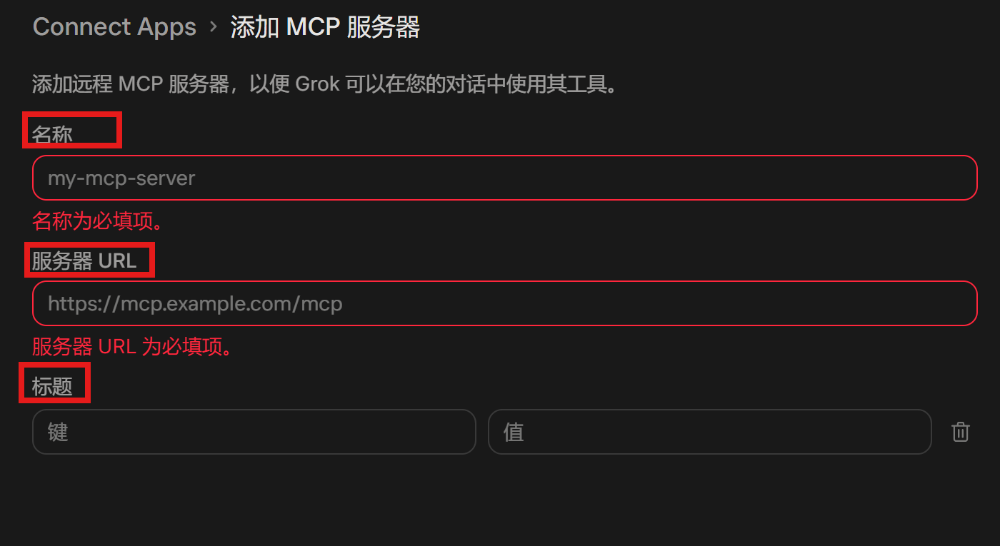
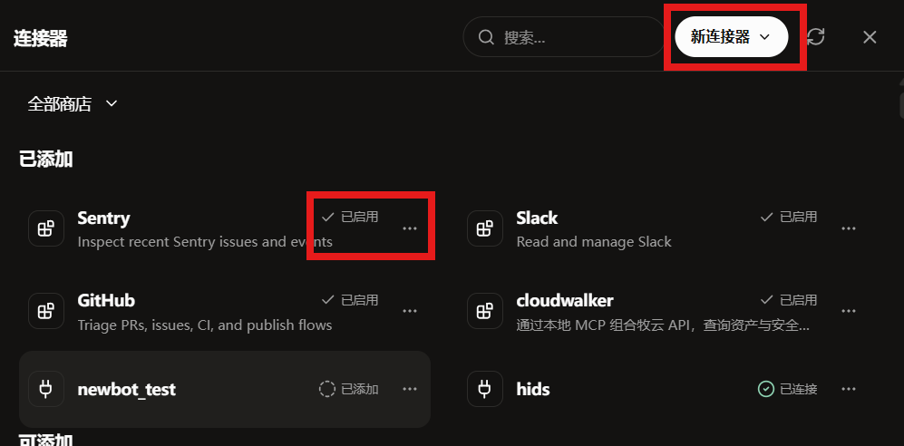
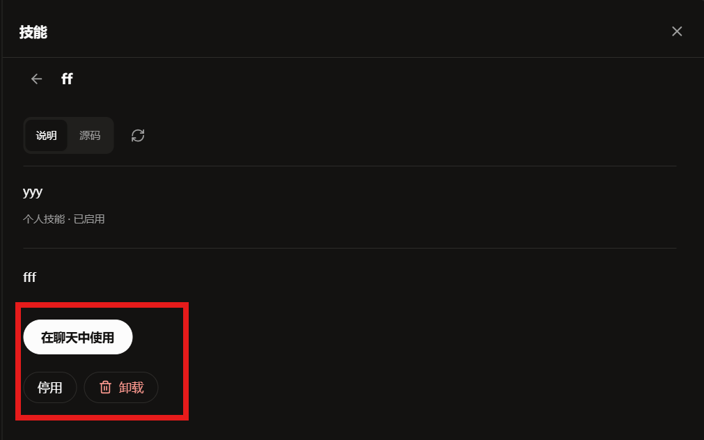
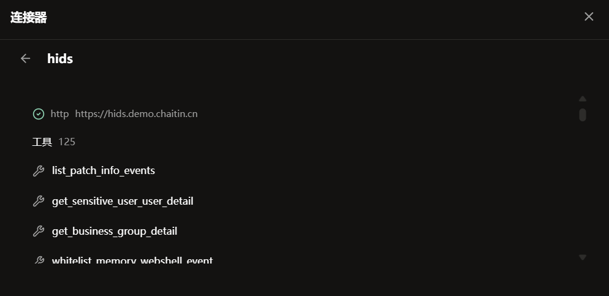
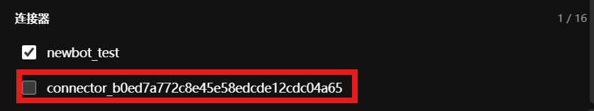

专家里面如果在配置技能等小窗口滚动，应该是滚动到上下边缘，然后就可以外部框继续滚动

感觉还是需要标题，比如这个

请你仔细分析grok的相关功能，确保对齐，包括但不限于，字体，字体颜色，交互，动画，连续性，配色等；

这个改成 + 呢？然后其它类似地方也同步修改，是否可以用lint来约束呢
还有当有说明的时候，启用状态出现与设置的三个点偏离了

这个排版和颜色不优雅，很别扭，然后是否可以放在上面某个位置，而不是放在底部出现说明和源码切换导致按钮往下挤，弹跳；然后技能首页要与连接器等统一心智模型，已经启用 + 三个点之类的

连接器里面显示的工具，似乎放在了一个小框框里面，感觉很别扭

模型服务需要支持搜索，与前面的统一心智，请将相关的类似交互功能都统一成一套合理的心智交互；

创建专家的时候，这个连接器的名称似乎人类阅读不友好

能用ico清晰表示含义就用ico