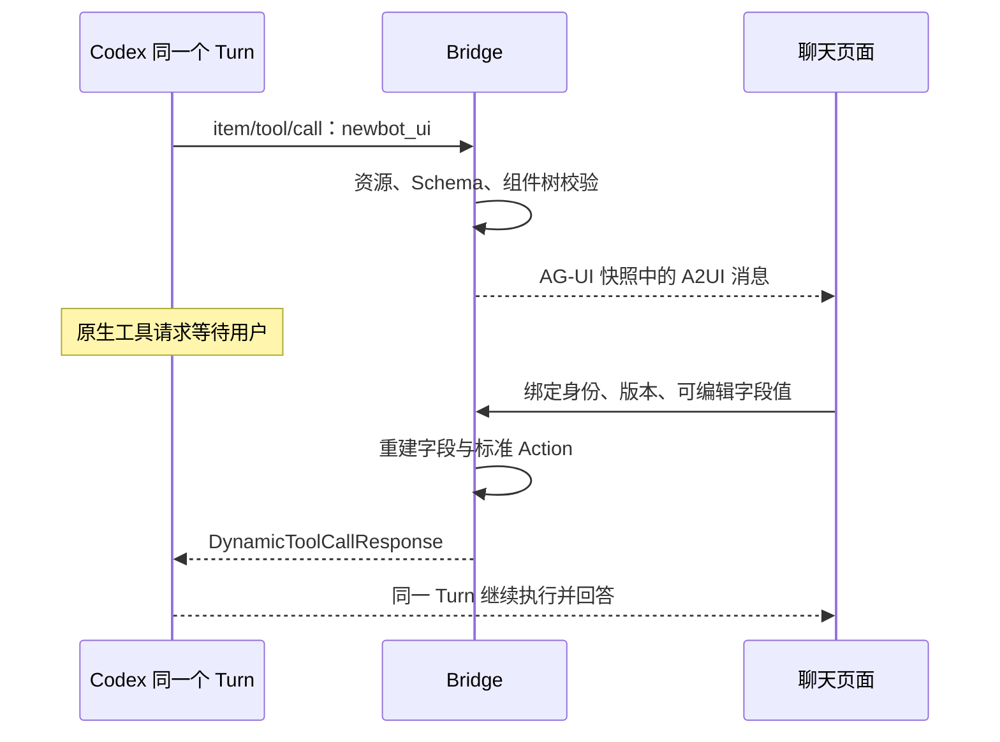

# A2UI 真实 Agent 与聊天操作回传（D5.3）

日期：2026-11-08。D5.3 已接通新对话中的原生表单生成、增量更新、会话/消息关联和用户操作回传。Codex 仍是唯一 Agent 内核。本轮是功能开发验证，正式部署与上线统一验收仍在 R1。

## 原生调用路径

新建线程时注册一个 `newbot_ui` 动态工具，参数是标准 A2UI v0.9 `messages` 和是否等待用户操作的 `waitForAction`。组件 Schema 从同一份受限 Catalog 生成，不维护另一份工具组件定义。短对话仍用 Markdown；结构化答案按下一节的优先级选择表面。

Codex 0.166.0 的动态工具字段需要实验性协议。生成脚本已改为 `generate-ts --experimental`，仍使用固定版本二进制，相关字段全部自动生成。初始化原本已经声明 `experimentalApi: true`。注册、`item/tool/call` 请求及工具响应流见 [OpenAI 官方 App Server 文档](https://learn.chatgpt.com/docs/app-server)。没有改写 Agent Loop 或添加第二个 MCP 客户端。



`waitForAction: false` 用于展示或增量更新，工具立即返回；`true` 保留原生请求，等待实际用户操作后返回。UI 生命周期独立于浏览器连接，刷新或关闭浏览器不会自动取消原生任务。当前等待上限为 10 分钟，到期返回输入不可用并禁用旧表单。

## 呈现优先级与失败修复

每轮 `developerInstructions` 给出固定顺序：带 `ui://` 的 MCP 工具 → `newbot_ui` 富表面 → Markdown。`newbot_ui` 的触发条件可直接判定：两组及以上可比数值序列用 Chart，三条及以上标签/数值用 Column + Metric，用户已有图片用 Image，两个及以上待填字段用交互表单；同一份数据不得同时用表面和 Markdown 表格展示，短对话保持文本，也不得虚构数据或来源。

调用失败时工具结果返回 `{error, hint}`，`hint` 按错误码给出下一步动作（补齐一次完整树、降到限额内、移除禁用键等）并要求修正后重试一次，不再是所有错误共用一条泛化提示。失败不改变权限，也不会被包装成成功。

存量线程（`thread-ui` 非 v2）没有注册该工具：`ThreadResumeParams` 不含 `dynamicTools`，无法在 resume 时补发，指令分支因此明确要求这些线程不要使用 v2 组件。覆盖它们需要内核补丁或新建对话。

## 会话、消息与事件关联

服务端从原生请求取得 `threadId`、`turnId` 和 `callId`，并验证线程归属及当前活跃 Turn。表单第一次显示的原生 Item 是固定挂载位置；同一 Turn 内后续更新仍修改该位置，不重复堆叠完整表单。

浏览器通过既有 AG-UI Item/线程快照接收 `A2uiView`，其中 `messages` 保持标准 A2UI 描述。框架没有引入另一套富文本协议或 WebSocket 消息语义。未经校验的原生 UI 工具参数不会作为 UI 下发，工具参数流只保留占位，失败的原始输入也不会进入产品错误信息。

新建线程保存工具注册信息；已有旧线程没有该注册，本轮没有自动迁移或分叉它们。`capabilities.a2ui` 明确报告 `newThreadsOnly: true` 和 `historyRestoration: true`（D5.4 已补齐）。需要体验时应新建对话，例如“用可填写的表单收集一个监控任务的名称、服务器和监控指标”。

## 操作经过服务端重建

只开放以下产品接口，沿用登录、Session Cookie、Origin 和日志边界：

- `GET /api/a2ui/:id`：读取当前已登记表单。
- `POST /api/a2ui/action`：提交来源标识和可编辑字段。

浏览器提交 View/线程/Turn/Item/Surface、版本、一次性请求令牌、请求 UUID、按钮组件 ID 和字段值。它不能指定事件名、可信上下文、执行目标、代码或回调地址。

Bridge 每次检查绑定身份、当前原生请求、版本、令牌、允许按钮和字段集合。只接受表单中有绑定的 TextField/ChoicePicker，限制类型、长度、选项及重复选择，拒绝未知字段、只读字段和相互冲突的重叠绑定。字段重建使用副本，不能通过别名修改提交对象来绕过一致性比较。

然后，Bridge 按已登记按钮的定义解析上下文，返回标准 `{version: "v0.9", action: {name, surfaceId, sourceComponentId, timestamp, context}}`，经原生 `DynamicToolCallResponse.contentItems` 交回 Codex。只允许 `submit` 和 `cancel`。Host 还提供独立的“取消填写”，即使模型没有生成取消按钮也能结束等待。

原生响应仍只包含普通用户输入。它不会批准 Shell、MCP 或其他有副作用的工具；后续工具继续走 Codex 原有沙箱和审批。固定的普通输入提示始终显示，私密输入能力仍为 false，凭证通道留在 D6。

## 并发与失败处理

每个线程最多一个表单等待，内存最多保留 32 个 SDK 实例，关闭实例可从持久化快照按需恢复，每份最多 128 次更新。活动表单不会为腾出空间被驱逐。表单等待也阻止配置切换和维护重启，运行指标增加 `pendingForms`。

提交期间禁用字段、按钮、Host 取消和重载；服务端也设单次消费门。消费先于原生管道写入，即使结果未确认，也不会重新授权同一个原生请求。相同 UUID 和内容的重试返回已有回执；同 UUID 不同内容、旧版本或新 UUID 重复消费会失败。回执仅存 UUID、指纹和接受/未知状态，不存字段值；D5.4 已改为持久化写入，详见恢复记录。

网络失败保留当前输入并重试原 UUID；状态冲突重新读取服务端。中断、原生请求失效、进程离线和超时都会撤销旧令牌。表单以本产品 React 组件按需加载，支持桌面/手机、主题、键盘、只读和重载。

## 开发验证

```bash
npm run generate:codex
npm test
npm run build
npm run test:a2ui-chat-ui
npm run test:a2ui-catalog-ui
npm run test:a2ui-ui
npm run test:app-host-ui
npm run test:elicitation-ui
# 使用已配置模型执行一轮真实任务与浏览器交互
npm run test:a2ui-live
```

新增 12 项自动测试：11 项服务端链路检查，以及 1 项重叠绑定原子性检查。全量 **194 项自动测试**通过，类型检查及构建通过。

新增 **12 项聊天浏览器检查**通过，覆盖消息挂载与增量更新、字段提交、只读结果、刷新重接、两种取消、传输失败与原 UUID 重试、过期版本、手机深色、中断及普通 Markdown。另有 **32 项 A2UI 样例/组件回归**、**14 项 MCP Host** 和 **15 项普通输入**回归通过，共 73 项相关浏览器检查。

真实验证使用 Codex 0.166.0 和 `gpt-6.1-sol`。模型实际发起一次 `newbot_ui`，在真实聊天页面显示其生成的任务表单；浏览器输入随机任务名并提交后，原 Turn 返回包含该值的最终回答。验证只有一次 `turn/start`，无 Shell/MCP/文件修改/搜索工具，没有浏览器 pageerror，结束时无待处理表单。证据在 `.data/a2ui-live/result.json`、桌面/手机截图及 `.data/a2ui-agent/`。

手机检查会先收起侧栏，再核对输入框中心能够实际命中控件，避免仅检查 DOM 尺寸却把被遮挡的表单当作通过。真实流程的最终回答、提交状态和手机深色表单均已人工查看截图。

现有测试服务也已完成空闲检查、维护锁、备份及重启；新能力和 Cloudflare 入口读取通过，登录、历史和数据库保留，见 [服务同步记录](test-service-update.md)。没有在共享实例创建模型任务或改变现有 Provider/MCP 定义。

## 依赖和下一批范围

共享的受限运行时移至 `shared/a2ui-runtime.ts`；前后端复用同一 Catalog、资源限额和绑定检查。后端所需 `@a2ui/web_core`、匹配的 `zod3` 别名及 Schema 转换库已进入生产依赖；React SDK 留作构建依赖，由 Vite 打包。

当前生产依赖审计报告 **2 项 high**，全量依赖报告 **4 项 high**，源于固定 SDK 仍使用旧版 Zod。沿用 D5.2 的处理前预算、无可执行函数/正则和 64 MiB 数组路径测试缓解，不将其描述为上游漏洞已修复。目标环境、完整资源指标和上线安全验收仍在 R1。

D5.4 已完成最少 UI 快照、Bridge 重启后的只读历史、服务端草稿与 CAS 冲突、到期提示及不完整/非法描述降级，见 [恢复记录](a2ui-recovery.md)。D5.3 的上述测试数量为当时记录，当前全量为 209 项自动测试及 81 项相关浏览器检查。私密输入仍留在 D6。
