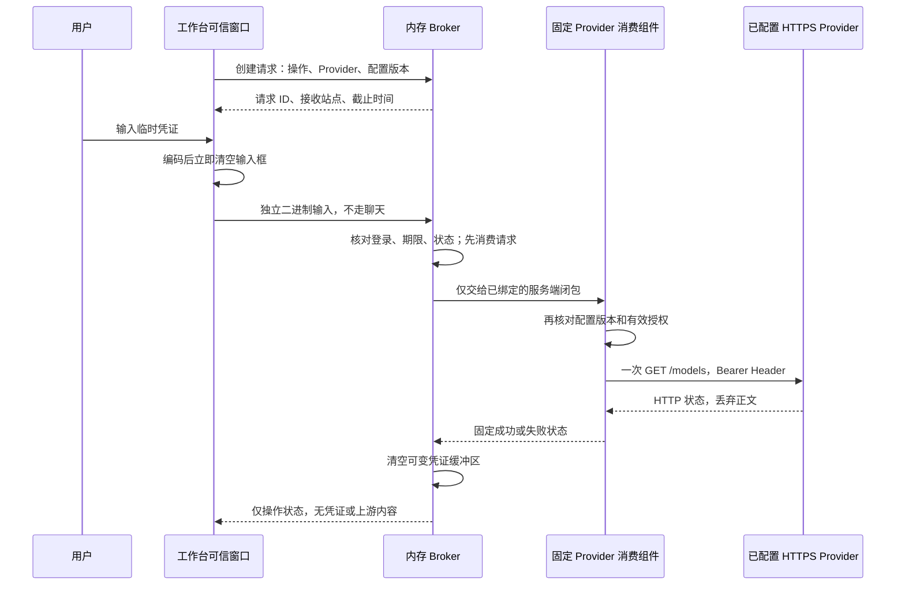

# 可信私密输入与首个受信消费者（D6.1–D6.2）

日期：2026-11-09。本文记录 D6.1–D6.2 的临时检查；D6.3 已增加保存与原生载入，当前范围见 [凭证保存记录](credential-storage.md)。

本轮完成内存 Credential Broker、请求身份/期限/取消/单次消费，以及一个可实际使用的临时 Provider API Key 检查。Codex 仍为唯一 Agent 内核；没有增加模型网关、独立服务或新的 MCP 客户端。

## 已开放的操作

进入“设置 → 模型与 Provider”，在支持的 Provider 上选择“临时验证 … 的凭证”。工作台显示固定接收站点、操作和截止时间。上游完整配置路径保留在服务端，避免把旧配置中可能含有的秘密路径下发到浏览器。用户填写临时 API Key 后点“仅验证一次”。

当前操作只有 `provider.models.test`：向已配置的 HTTPS Responses Provider 发出一次带 Bearer 凭证的 `GET /models`。接收方来自服务端 Codex 有效配置，不接收浏览器提供的 URL、Header、命令、工具身份、代码或回调。配置摘要中的 `temporaryCredentialTest` 决定入口是否显示；账户授权、HTTP、带 URL 凭证/查询参数及不支持的协议不开放入口。

本次检查不修改 Provider 配置、不替换现有环境变量或静态 Header、不创建模型任务。成功仅说明端点返回 2xx；端点是否实际校验密钥由上游决定，不能据此宣称模型、流式或工具兼容性已通过。401/403、重定向和网络错误只返回固定状态。

## 凭证路径

没有公开的“读取秘密”或“按句柄领取凭证”接口。受信消费者在创建请求时固定为服务端闭包，输入接口只能触发这一消费者；请求 ID 本身不能指定接收组件或目标。此阶段不向 Agent 注册私密输入工具，模型和 MCP App 不能要求 Broker 执行任意凭证操作。

## 身份、生命周期与消费

每个请求绑定当前登录 Session 的摘要、Provider ID、配置版本、固定操作和接收方，最长 2 分钟。读、取消、提交均要求原 Session；主 API 继续核对精确 Origin，第三方 App origin 不能访问。私密创建和输入的浏览器 Origin 额外限定为 HTTPS 主站或回环开发地址，主站 TLS 由现有 HTTPS 入口终止。

状态为准备、等待、检查中、成功、失败、取消、过期或失效。服务端在异步检查前消耗等待状态，一次请求最多发出一次上游调用；失败、响应丢失及精确重试都不会重新发送凭证。创建请求使用 UUID 幂等，同一 UUID 不能更改绑定参数。浏览器遇到发送结果不明时只读取状态，凭证已清空，不自动重传。

取消、过期、登出、登录失效和运行时离线会撤销请求、清空 Broker 持有的可变缓冲区并中止上游等待。已经发出的请求不能撤回。关闭私密窗口或刷新页面时尝试发送取消；断网导致取消无法送达时，服务端期限仍生效，不影响 Codex 后台任务。Bridge 关闭后通道不可继续使用；重启时请求和秘密均不恢复，旧输入 ID 返回不存在。

每个登录最多 4 个活动请求，全实例最多 16 个活动请求、128 条请求记录。终态只保留操作元数据，约 10 分钟后清理；凭证不保留。私密请求也会阻止配置切换及维护重启，`pendingPrivateInputs` 可用于更新前的空闲检查。

## 输入、输出与存储边界

凭证只从独立的 `application/octet-stream` 路径接收，最多 4096 字节，仅允许非空、不含空格和控制字符的可见 ASCII。普通聊天、A2UI 和 MCP Elicitation 继续保持普通信息输入，不能借此获得私密权限。

浏览器使用非受控密码输入框，不将值放入 React/Zustand 状态或 localStorage/sessionStorage。发送时清空 DOM，最后清空发送缓冲区。服务端在完成、异常和取消时清空 Buffer，并释放消费者引用；不保存凭证到 SQLite、Codex 配置、环境变量或文件。JS/HTTP 栈中的不可变字符串副本不承诺堆级强擦除，这不是操作系统级秘密隔离。同一宿主用户下的恶意进程或调试器也不在此模块的强隔离边界内。

HTTPS 消费者使用固定方法/地址，校验证书，不跟随重定向，不自动重试，不合并旧 Provider 的 Header 或凭证，也不解析上游正文。正常、错误及反射凭证的响应均只转成固定枚举。测试用 CA 只通过内部服务器工厂注入，浏览器接口不能指定证书或关闭校验。

运行日志只记路由模板、方法、耗时和状态；审计只记请求 UUID 与固定操作状态，不记录请求体、Header、原始错误或上游正文。现有 OpenTelemetry 继续只使用显式元数据 Span，没有启用 HTTP 自动采集。D6.5 仍需针对后续保存、MCP 和 sudo 通道完成完整 Trace 与输出矩阵，本轮不把这些未开放路径标记为已验证。

## 产品接口和能力

| 接口                              | 内容                                          |
| --------------------------------- | --------------------------------------------- |
| `POST /api/credentials/requests`  | 严格白名单操作、Provider、配置版本和请求 UUID |
| `GET /api/credentials/:id`        | 当前登录下的操作元数据和状态                  |
| `DELETE /api/credentials/:id`     | 撤销等待/检查，释放缓冲区                     |
| `POST /api/credentials/:id/input` | 二进制私密输入，返回固定状态                  |

`privateCredentials: true` 表示已有可用的受限通道，具体范围由 `trustedInput` 明确报告：`apiKeyProbe: true`、唯一操作 `provider.models.test`，而 `persistence`、`agentRequests`、`sudo` 均为 `false`。A2UI 的 `privateInput` 和 MCP Elicitation 的敏感输入仍为 `false`，不将普通表单重新解释成私密输入。

## 开发验证与后续

开发测试使用系统 OpenSSL 生成临时自签名证书，浏览器检查沿用 Chromium/Playwright；生产消费者不依赖 OpenSSL 命令行。

`npm test` 全量 **224 项**通过；本轮新增 15 项，覆盖单次消费/幂等、身份/来源/操作白名单、取消清零、过期、配额、真实 TLS、配置变化、反射/重定向/错误、登出中止、进程重启、非 TLS 来源和 App/Agent 越权。类型检查和构建通过。

`npm run test:credentials-ui` 的 **12 项**浏览器检查通过，覆盖可信接收方、掩码/焦点、真正 HTTPS 消费、清空/防重放、取消/Escape、反射/重定向、配置冲突、过期、断网只读状态、手机深色及泄漏检查。另有 Provider 18 项、配置恢复 13 项、MCP Host 14 项、普通输入 15 项和 A2UI 聊天 20 项回归，共 **92 项**相关浏览器检查。截图已查看，无横向溢出，按钮可触达，焦点可恢复。

真实消费验证使用本地 TLS 服务和合成凭证；服务端验证收到的 Authorization，返回带凭证的恶意反射正文/响应头，以确认 Bridge 不转发这些内容。不是静态 UI 或模拟成功按钮，也没有使用用户实际密钥、访问付费 Provider 或创建模型 Turn。证据在 `.data/credentials-ui/`、`.data/credentials/` 和 `tests/credentials.test.ts`。

D6.1–D6.2 完成。下一批 D6.3 为 Provider/MCP 的秘密写入和不可回读流程，临时持有与明确选择的加密保存需分别定义受信消费者；再完成 D6.4 的 sudo 通道与 D6.5 的完整输出验证。正式部署和上线统一验收仍留在 R1。
